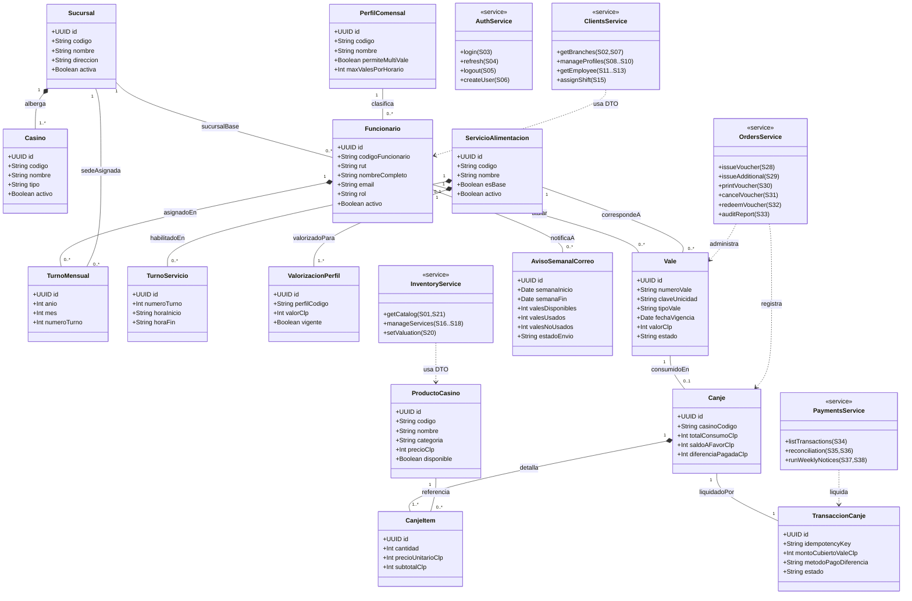
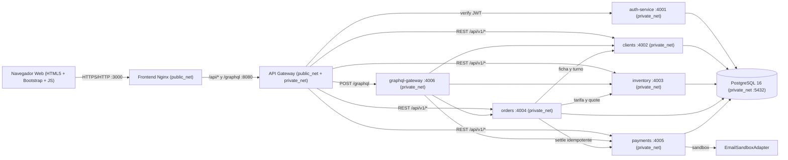
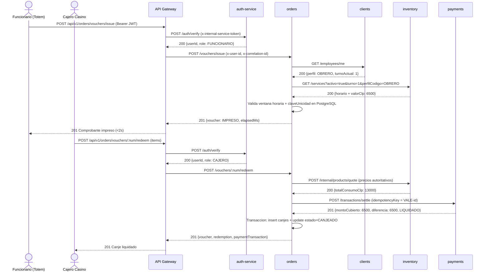
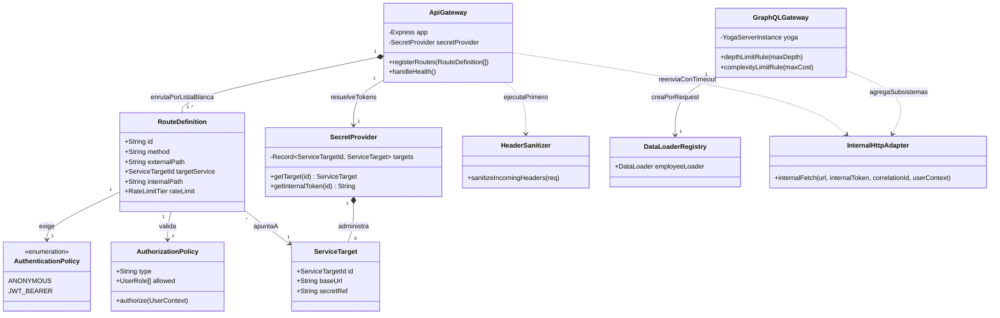

# Informe de Arquitectura y Backend Seguro — Unidad 2

**Caso de Negocio:** Caso 18 — *"Sistema de Emisión y Control de Vales de Alimentación"*  
**Empresa:** Libros Impresos S.A. (500 funcionarios en expansión a 1.000 con Sucursal Imprenta Norte, operación 24/7 en 3 turnos mensuales)  
**Versión del Frontend Integrado:** `v1.0.0` (HTML5 + Bootstrap 5.3 Grid + CSS3 Box/Flex + JavaScript Vanilla ES Modules en `frontend/`)  
**Versión del Backend:** `v1.0.0` (Node.js 24 LTS + TypeScript Strict + Express + Zod + GraphQL Yoga + Prisma ORM + PostgreSQL 16 + Pino)

---

## Punto de Partida y Resolución de Brechas del Frontend

En la Evaluación 1 el prototipo front-end se enfocó en el actor principal y su flujo de consulta/emisión. Para cubrir íntegramente los casos de uso **CU1–CU9** y los requisitos **RF01–RF14** de Caso 18, se incorporaron y conectaron las siguientes pantallas reales (sin datos dummy):

| ID Pantalla | Archivo Modular | Casos de Uso | Descripción y Brecha Resuelta |
| :--- | :--- | :--- | :--- |
| `P01` | `frontend/js/views/loginView.js` | `CU1` | Autenticación con código de funcionario + contraseña y consulta pública del catálogo del casino externo. |
| `P02` | `frontend/js/views/totemView.js` | `CU2`, `CU7`, `CU9` | Tótem del funcionario conectado vía GraphQL (`miResumenComensal`), emisión/impresión `< 2s`, selector de sucursal en línea, multi-vale e historial/avisos semanales. |
| `P03` | `frontend/js/views/cashierView.js` | `CU5` | Caja del casino externo: búsqueda de vale, carrito de productos, cálculo de saldo a favor o diferencia a pagar y liquidación real. |
| `P04` | `frontend/js/views/adminView.js` | `CU3`, `CU4`, `CU6`, `CU7`, `CU8`, `CU9` | Panel administrativo con 4 pestañas: Auditoría/Rendición/SP semanal, Servicios extensibles/Valorizaciones, Perfiles/Turnos y Control/Emisión de vales adicionales y visitas. |
| `P05` | `frontend/js/views/helpView.js` | `RNF12`, `RNF14` | Módulo de ayuda en línea con reglas operativas de turnos, multi-vale, canje y multi-sucursal. |

---

## Módulo 1 — Servicios Derivados del Frontend y Contratos JSON

### 1.1 Matriz Completa de Servicios Públicos (Expuestos vía API Gateway)

> **Nota sobre variación visual:** Las vistas responsivas en `375px`, `768px`, `1024px` y `1440px` comparten exactamente los mismos endpoints y contratos; una adaptación de layout no crea servicios distintos.

| ID | Requisito | Pantalla y Acción | Propósito | Verbo y Ruta | Entrada | Salida | Reglas y Errores | Clasificación de Datos | Acceso |
| :--- | :--- | :--- | :--- | :--- | :--- | :--- | :--- | :--- | :--- |
| `S01` | `RF12` | `P01` Cargar catálogo público | Listar productos del casino sin exponer datos de funcionarios | `GET /api/v1/public/products` | Query opcional `?available=true\|false` | `200 { products: [{id, codigo, nombre, categoria, precioClp, disponible}] }` | `400 INVALID_FILTER` si `available` no es booleano | Público | Anónimo |
| `S02` | `RF11` | `P01/P02` Consultar sucursales | Listar sedes y casinos habilitados | `GET /api/v1/public/branches` | Sin cuerpo | `200 { branches: [{id, codigo, nombre, casinos}] }` | Solo sedes activas | Público | Anónimo |
| `S03` | `RF01, RF10` | `P01` Iniciar sesión | Verificar código y contraseña con bcrypt y emitir JWT | `POST /api/v1/auth/login` | `{ codigoFuncionario, password }` | `200 { accessToken, refreshToken, expiresIn, user }` | `400 VALIDATION_ERROR`, `401 INVALID_CREDENTIALS` | Credencial (entrada) / Sesión | Anónimo |
| `S04` | `RF10` | Global Renovar token | Renovar access token sin re-ingresar clave | `POST /api/v1/auth/refresh` | `{ refreshToken }` | `200 { accessToken, expiresIn, user }` | `401 SESSION_REVOKED / INVALID_REFRESH_TOKEN` | Credencial | Anónimo |
| `S05` | `RF10` | Global Cerrar sesión | Revocar sesión activa en PostgreSQL | `POST /api/v1/auth/logout` | Header `Authorization: Bearer` | `200 { ok: true, message }` | `401 UNAUTHENTICATED` si falta token | Operacional | Autenticado |
| `S06` | `RF01` | `P04` Registrar credencial | Crear acceso en `auth.users` con hash bcrypt | `POST /api/v1/auth/users` | `{ id?, codigoFuncionario, password, rol }` | `201 { id, codigoFuncionario, rol, activo }` | `403 FORBIDDEN` no admin; `409 USER_ALREADY_EXISTS` | Credencial | Autenticado (`ADMINISTRADOR`) |
| `S07` | `RF11` | `P02/P03/P04` Listar sucursales | Obtener sedes y casinos | `GET /api/v1/clients/branches` | Sin cuerpo | `200 { branches }` | Requiere sesión válida | Público operacional | Autenticado |
| `S08` | `RF06` | `P04` Consultar perfiles | Listar perfiles de comensales y flags multi-vale | `GET /api/v1/clients/profiles` | Sin cuerpo | `200 { profiles }` | Ordenado por código | Operacional | Autenticado |
| `S09` | `RF06` | `P04` Crear perfil | Crear nuevo perfil (normal o multi-vale) | `POST /api/v1/clients/profiles` | `{ codigo, nombre, descripcion, permiteMultiVale, maxValesPorHorario }` | `201 { profile }` | `403 FORBIDDEN`; `409 PROFILE_ALREADY_EXISTS` | Operacional | Autenticado (`ADMINISTRADOR`) |
| `S10` | `RF06` | `P04` Actualizar perfil | Modificar límite multi-vale o estado | `PUT /api/v1/clients/profiles/:id` | `{ nombre?, descripcion?, permiteMultiVale?, maxValesPorHorario?, activo? }` | `200 { profile }` | `404 PROFILE_NOT_FOUND` | Operacional | Autenticado (`ADMINISTRADOR`) |
| `S11` | `RF01, RF08` | `P02` Consultar ficha propia | Obtener perfil y turno mensual vigente del usuario | `GET /api/v1/clients/employees/me` | Sin cuerpo | `200 { employee }` | Identidad derivada solo del JWT verificado | Restringido personal (`rut`, `email`) | Autenticado |
| `S12` | `RF04` | `P04` Listar dotación | Obtener funcionarios y turnos vigentes | `GET /api/v1/clients/employees` | Query opcional `?ids=...` | `200 { employees }` | `403 FORBIDDEN` si no es Admin | Restringido personal | Autenticado (`ADMINISTRADOR`) |
| `S13` | `RF01` | API Consultar ficha por ID | Leer ficha individual con control anti-IDOR | `GET /api/v1/clients/employees/:id` | Param `:id` UUID | `200 { employee }` | `403 FORBIDDEN` si `userId !== id` y no es Admin | Restringido personal | Autenticado |
| `S14` | `RF01` | `P04` Crear funcionario | Registrar funcionario y turno inicial | `POST /api/v1/clients/employees` | `{ codigoFuncionario, rut, nombreCompleto, email, rol, perfilCodigo, sucursalCodigo, numeroTurno }` | `201 { employee }` | `403 FORBIDDEN`; `404 PROFILE/BRANCH_NOT_FOUND` | Restringido personal | Autenticado (`ADMINISTRADOR`) |
| `S15` | `RF08` | `P04` Asignar turno mensual | Actualizar turno (1/2/3) y sucursal asignada | `PUT /api/v1/clients/employees/:id/shift` | `{ anio?, mes?, numeroTurno, sucursalCodigo? }` | `200 { shift }` | `403 FORBIDDEN` no admin | Operacional | Autenticado (`ADMINISTRADOR`) |
| `S16` | `RF09` | `P02/P04` Consultar servicios | Listar servicios, horarios por turno y tarifas | `GET /api/v1/inventory/services` | `?activo=&turno=&perfilCodigo=` | `200 { services }` | `400 INVALID_FILTER` | Operacional | Autenticado |
| `S17` | `RF09` | `P04` Crear servicio extensible | Agregar nuevo servicio de alimentación y horarios | `POST /api/v1/inventory/services` | `{ codigo, nombre, descripcion, esBase, horarios, valorizaciones }` | `201 { service }` | `409 SERVICE_ALREADY_EXISTS` | Operacional | Autenticado (`ADMINISTRADOR`) |
| `S18` | `RF09` | `P04` Actualizar servicio | Modificar nombre, descripción o vigencia | `PUT /api/v1/inventory/services/:id` | `{ nombre?, descripcion?, activo? }` | `200 { service }` | `404 SERVICE_NOT_FOUND` | Operacional | Autenticado (`ADMINISTRADOR`) |
| `S19` | `RF03` | `P04` Listar valorizaciones | Consultar montos CLP por servicio y perfil | `GET /api/v1/inventory/valuations` | Sin cuerpo | `200 { valuations }` | Solo tarifas vigentes/registradas | Operacional | Autenticado |
| `S20` | `RF03` | `P04` Fijar valorización | Crear o actualizar monto CLP por servicio/perfil | `PUT /api/v1/inventory/valuations` | `{ servicioId, perfilCodigo, valorClp, vigente }` | `200 { valuation }` | `valorClp > 0`; `403 FORBIDDEN` | Operacional | Autenticado (`ADMINISTRADOR`) |
| `S21` | `RF12` | `P03` Listar productos casino | Obtener menú/productos disponibles para cajero | `GET /api/v1/inventory/products` | `?available=true\|false` | `200 { products }` | `400 INVALID_FILTER` | Público | Autenticado |
| `S22` | `RF12` | `P04` Crear producto | Agregar producto al catálogo del casino | `POST /api/v1/inventory/products` | `{ codigo, nombre, categoria, precioClp, disponible }` | `201 { product }` | `409 PRODUCT_ALREADY_EXISTS` | Operacional | Autenticado (`ADMINISTRADOR`) |
| `S23` | `RF12` | `P04` Actualizar producto | Cambiar precio o disponibilidad | `PUT /api/v1/inventory/products/:id` | `{ nombre?, categoria?, precioClp?, disponible? }` | `200 { product }` | `404 PRODUCT_NOT_FOUND` | Operacional | Autenticado (`ADMINISTRADOR`) |
| `S24` | `RF07` | `P02` Consultar mis vales | Listar vales propios y su historial de canje | `GET /api/v1/orders/vouchers/my` | `?estado=` opcional | `200 { vouchers }` | Filtrado por `userId` del token | Restringido propio | Autenticado |
| `S25` | `RF04, RF12` | `P04` Listar todos los vales | Filtrar vales emitidos, impresos, canjeados o anulados | `GET /api/v1/orders/vouchers` | `?estado=&servicioCodigo=&sucursal=&funcionarioId=` | `200 { vouchers }` | `403 FORBIDDEN` para `FUNCIONARIO` | Restringido operacional | Autenticado (`ADMIN/CAJERO`) |
| `S26` | `RF12` | `P03` Buscar vale por número | Consultar detalle de un vale para canje en caja | `GET /api/v1/orders/vouchers/by-number/:numeroVale` | Param `:numeroVale` | `200 { voucher }` | `FUNCIONARIO` solo ve propio (`403` si ajeno) | Restringido | Autenticado |
| `S27` | `RF07` | API Consultar vale por ID | Verificación de propiedad y persistencia por UUID | `GET /api/v1/orders/vouchers/:id` | Param `:id` UUID | `200 { voucher }` | `403 FORBIDDEN` si pertenece a otro funcionario | Restringido | Autenticado |
| `S28` | `RF02, RF03, RF07, RF08, RF11, RF13` | `P02` Emitir e imprimir vale | Validar turno/horario/unicidad y emitir en `< 2s` | `POST /api/v1/orders/vouchers/issue` | `{ servicioCodigo?, sucursalEmisionCodigo, nombreBeneficiarioVisita? }` | `201 { voucher, elapsedMs }` | `422 FUERA_DE_HORARIO`, `409 VALE_DUPLICADO`, `409 MULTIPLE_SERVICES_IN_WINDOW` | Restringido operacional | Autenticado |
| `S29` | `RF05` | `P04` Emitir vale adicional o visita | Generar vale `ADICIONAL_REUNION` o `VISITA_NO_PERSONALIZADO` | `POST /api/v1/orders/vouchers/additional` | `{ tipoVale, funcionarioCodigo?, nombreBeneficiarioVisita?, servicioCodigo, sucursalEmisionCodigo, motivoAdicional }` | `201 { voucher }` | `403 FORBIDDEN` no admin | Restringido operacional | Autenticado (`ADMINISTRADOR`) |
| `S30` | `RF05, RF07` | `P02` Imprimir vale adicional | Pasar vale `EMITIDO` a `IMPRESO` en tótem | `POST /api/v1/orders/vouchers/:id/print` | Param `:id` | `200 { voucher, elapsedMs }` | `403` si ajeno; `409 INVALID_STATE_TRANSITION` | Restringido operacional | Autenticado |
| `S31` | `RF07` | `P04` Anular vale | Marcar `ANULADO` conservando historial | `POST /api/v1/orders/vouchers/:id/cancel` | Param `:id` | `200 { voucher }` | `409 VOUCHER_ALREADY_REDEEMED` | Operacional | Autenticado (`ADMINISTRADOR`) |
| `S32` | `RF12` | `P03` Registrar venta/canje | Cotizar en `inventory`, liquidar en `payments` y marcar `CANJEADO` | `POST /api/v1/orders/vouchers/:numeroVale/redeem` | `{ casinoCodigo, items: [{productoId, cantidad}], metodoPagoDiferencia }` (`.strict()`) | `201 { voucher, redemption, paymentTransaction }` | `400 VALIDACION_ESTRICTA` si cliente envía precios/totales; `409 VALE_YA_CANJEADO` | Restringido financiero | Autenticado (`CAJERO`) |
| `S33` | `RF04` | `P04` Informe de auditoría | Conteo exacto de vales emitidos, usados y no usados | `GET /api/v1/orders/reports/audit` | `?fechaDesde=&fechaHasta=` | `200 { summary, byService, byEmployee }` | `403 FORBIDDEN` si no es Admin | Restringido auditoría | Autenticado (`ADMINISTRADOR`) |
| `S34` | `RF12` | `P03/P04` Consultar transacciones | Listar liquidaciones de canjes | `GET /api/v1/payments/transactions` | `?casinoCodigo=&valeId=` | `200 { transactions }` | `CAJERO` solo ve las propias | Restringido financiero | Autenticado (`ADMIN/CAJERO`) |
| `S35` | `RF04, RF12` | `P04` Consultar rendición | Consolidar vales canjeados por casino | `GET /api/v1/payments/reconciliation` | Sin cuerpo | `200 { summaryByCasino, closures }` | `403 FORBIDDEN` no admin | Restringido financiero | Autenticado (`ADMINISTRADOR`) |
| `S36` | `RF12` | `P04` Cerrar rendición mensual | Persistir cierre en `payments.rendiciones_casino` | `POST /api/v1/payments/reconciliation/close` | `{ casinoCodigo, anio, mes }` | `201 { closure }` | `403 FORBIDDEN` no admin | Restringido financiero | Autenticado (`ADMINISTRADOR`) |
| `S37` | `RF14, RNF04` | `P04` Ejecutar avisos semanales | Invocar SP `sp_generar_avisos_semanales` y despachar vía sandbox | `POST /api/v1/payments/notifications/weekly/run` | `{ fechaInicio?, fechaFin? }` | `200 { semanaInicio, semanaFin, providerMode, totalProcesados, dispatchedCount, notifications }` | `403 FORBIDDEN` no admin | Restringido personal (`emailDestino`) | Autenticado (`ADMINISTRADOR`) |
| `S38` | `RF14` | `P02/P04` Consultar avisos semanales | Listar avisos propios o globales | `GET /api/v1/payments/notifications/weekly` | Sin cuerpo | `200 { notifications }` | No-admin solo ve propios | Restringido personal | Autenticado |
| `S39` | `RF02-RF14` | `P02/P04` Consultas agregadas GraphQL | Componer datos de `clients`, `inventory`, `orders` y `payments` | `POST /api/v1/graphql` | `{ query, variables }` | `200 { data, errors? }` | `depth <= 4`, `complexity <= 500`, auth por campo | Mixto con control por campo | Autenticado |

### 1.2 Ejemplos Ilustrativos de Contratos JSON (Datos Ficticios de Diseño)

> **Rotulación explícita:** Los siguientes JSON son *ejemplos de contrato* para documentar la interfaz entre frontend y backend; no representan capturas de una ejecución real `RUNxx`.

**Ejemplo `S03` (`POST /api/v1/auth/login`):**
```json
{
  "request": { "codigoFuncionario": "EMP001", "password": "<PASSWORD_PRUEBA_FICTICIO>" },
  "response_200": {
    "accessToken": "<JWT_ACCESS_MASKED>",
    "refreshToken": "<JWT_REFRESH_MASKED>",
    "expiresIn": "15m",
    "user": { "id": "30000000-0000-4000-8000-000000000002", "codigoFuncionario": "EMP001", "role": "FUNCIONARIO" }
  }
}
```

**Ejemplo `S28` (`POST /api/v1/orders/vouchers/issue`):**
```json
{
  "request": { "servicioCodigo": "ALMUERZO", "sucursalEmisionCodigo": "CENTRAL" },
  "response_201": {
    "voucher": {
      "id": "uuid-ejemplo",
      "numeroVale": "VAL-20261124-A1B2C3",
      "codigoFuncionario": "EMP001",
      "nombreBeneficiario": "Carlos Munoz Perez",
      "perfilCodigo": "OBRERO",
      "servicioCodigo": "ALMUERZO",
      "servicioNombre": "Almuerzo",
      "tipoVale": "NORMAL_TURNO",
      "numeroTurno": 1,
      "valorClp": 6500,
      "sucursalEmisionCodigo": "CENTRAL",
      "estado": "IMPRESO"
    },
    "elapsedMs": 18
  }
}
```

**Ejemplo `S32` (`POST /api/v1/orders/vouchers/:numeroVale/redeem` — el cliente solo envía IDs y cantidades; el servidor cotiza y liquida):**
```json
{
  "request": {
    "casinoCodigo": "CASINO_CENTRAL_COMEDOR",
    "items": [{ "productoId": "50000000-0000-4000-8000-000000000001", "cantidad": 2 }],
    "metodoPagoDiferencia": "EFECTIVO"
  },
  "response_201": {
    "voucher": { "numeroVale": "VAL-20261124-A1B2C3", "estado": "CANJEADO", "valorClp": 6500 },
    "paymentTransaction": {
      "totalConsumoClp": 13000,
      "montoCubiertoValeClp": 6500,
      "saldoAFavorClp": 0,
      "diferenciaPagadaClp": 6500,
      "metodoPagoDiferencia": "EFECTIVO",
      "estado": "LIQUIDADO"
    }
  }
}
```

---

## Módulo 2 — Clases y Cardinalidades del Dominio

### 2.1 Diagrama UML de Clases del Dominio y Servicios Públicos



**Leyenda de Notación UML:** `*--` Composición (ciclo de vida dependiente), `--` Asociación estructural con multiplicidad explícita en ambos extremos, `..>` Dependencia de uso de DTO/contrato por un `«service»`.

### 2.2 Tabla de Cardinalidades y Reglas de Negocio

| Clase Origen | Multiplicidad | Clase Destino | Regla de Negocio que la Justifica |
| :--- | :--- | :--- | :--- |
| `Sucursal` | `1` — `1..*` | `Casino` | Toda sucursal operativa cuenta con al menos un casino (comedor o cafetería). |
| `PerfilComensal` | `1` — `0..*` | `Funcionario` | Cada funcionario posee exactamente un perfil (`OBRERO`, `JEFE`, `GERENTE`, `SECRETARIA_GERENCIA`), mientras un perfil agrupa a cero o más funcionarios. |
| `Funcionario` | `1` — `0..*` | `TurnoMensual` | Los turnos rotan mensualmente (`UNIQUE(funcionario_id, anio, mes)`). |
| `ServicioAlimentacion` | `1` — `0..*` | `TurnoServicio` | Los servicios base tienen 1 o más ventanas por turno (`DESAYUNO` en T1 y T3), mientras un servicio exclusivamente adicional (`REUNION_COFFEE`) puede tener 0 ventanas automáticas de turno. |
| `ServicioAlimentacion` | `1` — `1..*` | `ValorizacionPerfil` | Todo servicio activo debe tener al menos una valorización CLP definida por perfil. |
| `Funcionario` | `0..1` — `0..*` | `Vale` | Un vale personalizado pertenece a `1` funcionario; un vale `VISITA_NO_PERSONALIZADO` (CU7) tiene `0` funcionario titular (`funcionarioId = null`). |
| `Vale` | `1` — `0..1` | `Canje` | Un vale emitido puede no usarse nunca (`0`) o canjearse exactamente una vez (`1`, asegurado por `UNIQUE(vale_id)`). |
| `Canje` | `1` — `1..*` | `CanjeItem` | Todo canje registrado en caja incluye al menos un producto consumido (`min(1)` en Zod). |
| `Canje` | `1` — `1` | `TransaccionCanje` | Todo canje exitoso en `orders` corresponde biunívocamente a una liquidación confirmada en `payments`. |

**Separación Modelo Interno vs DTO:** Entidades internas como `auth.users.passwordHash`, `auth.sessions.refreshTokenHash`, `orders.vales.claveUnicidad` y `payments.transacciones_canje.idempotencyKey` **nunca** se exponen en los DTO del frontend ni en los tipos GraphQL.

---

## Módulo 3 — Sistemas e Integraciones

### 3.1 Matriz de Subsistemas y Responsabilidades

| Sistema | Naturaleza | Responsabilidad Autorizada | Datos que Administra (Esquema Propio) | Servicios Asociados | Dependencias | Contrato de Integración | Credencial Requerida | Respuesta ante Fallos |
| :--- | :--- | :--- | :--- | :--- | :--- | :--- | :--- | :--- |
| `gateway` | Frontera Pública | Único punto HTTP público; sanitiza cabeceras, valida JWT, aplica rate limit y enruta | Políticas y rutas en memoria | `S01`–`S39` | Todos los internos | HTTP/REST/GraphQL sobre `private_net` | Emite `x-internal-service-token` vía `SecretProvider` | `503`/`504` con `X-Correlation-ID` sin stack trace |
| `auth-service` | Privado (Seguridad) | Identidad, hash `bcrypt`, JWT y revocación de sesiones | `auth.users`, `auth.sessions` | `S03`–`S06`, `/auth/verify` | PostgreSQL (`auth`) | REST JSON privado | `INTERNAL_TOKEN_AUTH` | `401` si sesión revocada o inválida |
| `clients` | Privado (Dominio) | Catálogo de sucursales/casinos, perfiles, funcionarios y turnos mensuales | `clients.*` | `S02`, `S07`–`S15` | PostgreSQL (`clients`) | REST JSON privado | `INTERNAL_TOKEN_CLIENTS` | `403` anti-IDOR; `404` si no existe |
| `inventory` | Privado (Dominio) | Servicios extensibles, horarios, tarifas por perfil y precios oficiales del casino | `inventory.*` | `S01`, `S16`–`S23`, `/internal/products/quote` | PostgreSQL (`inventory`) | REST JSON privado | `INTERNAL_TOKEN_INVENTORY` | Rechaza producto no disponible (`409`) |
| `orders` | Privado (Transaccional) | Ciclo de vida del vale (`EMITIDO` → `IMPRESO` → `CANJEADO`/`ANULADO`), unicidad y canjes | `orders.*` | `S24`–`S33` | `clients`, `inventory`, `payments`, PostgreSQL (`orders`) | REST JSON privado | `INTERNAL_TOKEN_ORDERS` + tokens destino | `409` duplicado/canjeado; `422` fuera horario; `503` si falla `payments` (sin marcar canje) |
| `payments` | Privado (Financiero) | Liquidación idempotente, rendición de casinos y avisos semanales (SP + correo) | `payments.*` | `S34`–`S38`, `/transactions/settle` | PostgreSQL (`payments`), `EmailSandboxAdapter` | REST JSON + PL/pgSQL `sp_generar_avisos_semanales` | `INTERNAL_TOKEN_PAYMENTS`, `EMAIL_API_KEY` | Idempotencia por `idempotencyKey`; nunca cobra dos veces |
| `graphql-gateway` | Privado (Agregación) | Composición multi-subsistema, DataLoader anti-N+1, límites de profundidad/costo | Sin BD propia (solo lectura agregada) | `S39` | `clients`, `inventory`, `orders`, `payments` | GraphQL over HTTP | `INTERNAL_TOKEN_GRAPHQL` + tokens destino | Captura errores de subsistemas no críticos en `partialErrors` |
| `EmailSandboxAdapter` | Adaptador Externo Sandbox | Simular envío SMTP/API de avisos semanales preservando contrato | Sin estado propio | Usado por `S37` | Ninguna externa en entorno académico | Clase TS invocada por `payments` | `EMAIL_API_KEY` (solo backend) | Registra `ERROR` en `avisos_semanales_correo` sin abortar SP |

### 3.2 Mapa de Componentes y Flujo de Red



### 3.3 Diagrama de Secuencia Representativo (Emisión CU2 + Canje CU5)



---

## Módulo 4 — Stakeholders y Permisos HTTP

### 4.1 Registro de Stakeholders (Operativos y No Operativos)

| Stakeholder | Categoría | Interés en el Sistema | Rol / Identidad Asociada | Uso de Información / Acceso |
| :--- | :--- | :--- | :--- | :--- |
| Funcionario Comensal | Actor operativo | Imprimir su vale en tótem según turno y sucursal, consultar historial | `FUNCIONARIO` | Invoca `P01`, `P02`, `S03..S05`, `S11`, `S24`, `S27`, `S28`, `S30`, `S38`, `S39` sobre recursos propios |
| Secretaria de Gerencia | Actor operativo | Emitir múltiples vales para visitas de gerencia en el mismo horario | `FUNCIONARIO` (perfil `SECRETARIA_GERENCIA`) | Mismos endpoints que `FUNCIONARIO` habilitados con `permiteMultiVale = true` |
| Cajero Casino Externo | Actor operativo | Validar vale, registrar consumo y liquidar diferencia o saldo a favor | `CAJERO` | Invoca `P03`, `S21`, `S25`, `S26`, `S32`, `S34` |
| Administrador | Actor operativo | Gestionar servicios, tarifas, perfiles, turnos, vales adicionales y auditoría | `ADMINISTRADOR` | Acceso administrativo completo `P04`, `S06..S39` |
| Gerencia General | Parte interesada **sin permisos operativos** | Supervisar cumplimiento alimenticio y costos globales | *Sin cuenta operativa* | Recibe informes consolidados exportados desde `P04` / `S33` y `S35` por el Administrador |
| Contabilidad Empresa Externa | Parte interesada **sin permisos operativos** | Conciliar mensualmente los vales cobrados vs servicios prestados | *Sin cuenta operativa* | Recibe cierre de rendición generado por `S36` (`payments.rendiciones_casino`) |
| Auditoría Interna / RR.HH. | Parte interesada **sin permisos operativos** | Detectar funcionarios que no consumen sus vales en jornada | *Sin cuenta operativa* | Recibe reporte `S33` (`byEmployee`) y avisos `S37` emitidos por el Administrador |
| API Gateway (`gateway`) | Identidad técnica | Enrutar y transportar contexto de usuario verificado | `x-internal-service-token` por destino | Autentica al borde y propaga identidad firmada |

### 4.2 Matriz de Permisos HTTP por Rol, Servicio y Condición

> **Criterio de integridad histórica:** Ningún rol tiene `DELETE` físico sobre vales ni canjes. `S31` (`POST /vouchers/:id/cancel`) realiza transición lógica a `ANULADO` conservando el registro para auditoría. Ocultar botones en el frontend **no** reemplaza las validaciones del backend.

| Rol / Identidad | Servicio | Ruta | GET | POST | PUT | DELETE | Alcance, Condición y Lugar de Verificación |
| :--- | :--- | :--- | :--- | :--- | :--- | :--- | :--- |
| Anónimo | `S01, S02` | `/api/v1/public/products`, `/branches` | Permitido | Denegado | Denegado | Denegado | Solo campos públicos de catálogo (`gateway` + `inventory`/`clients`) |
| Anónimo | `S03, S04` | `/api/v1/auth/login`, `/refresh` | N/A | Permitido | N/A | N/A | Rate limit estricto (`authLimiter` en `gateway`) |
| Anónimo | Cualquier ruta protegida | `/api/v1/orders/*`, `/graphql`, etc. | Denegado | Denegado | Denegado | Denegado | Rechazado con `401 UNAUTHENTICATED` en `gateway` |
| `FUNCIONARIO` | `S13` | `/api/v1/clients/employees/:id` | Condicional | Denegado | Denegado | Denegado | Permitido **solo** si `req.userContext.userId === :id` (verificado en `clients`) |
| `FUNCIONARIO` | `S27, S30` | `/api/v1/orders/vouchers/:id`, `/:id/print` | Condicional | Condicional | Denegado | Denegado | Permitido **solo** si `vale.funcionarioId === userId`; `print` exige `estado === 'EMITIDO'` (`orders`) |
| `FUNCIONARIO` | `S28` | `/api/v1/orders/vouchers/issue` | N/A | Permitido | N/A | N/A | Turno vigente, ventana horaria activa y unicidad (`orders`) |
| `FUNCIONARIO` | `S17, S29, S32, S33` | Servicios admin y canje en caja | Denegado | Denegado | Denegado | Denegado | Rechazado con `403 FORBIDDEN` en `gateway` **y** en microservicio (`requireRoles`) |
| `CAJERO` | `S26, S32, S34` | `/vouchers/by-number/:num`, `/:num/redeem`, `/transactions` | Permitido | Permitido | Denegado | Denegado | Canje permitido solo para vales en estado válido; en `S34` solo ve sus propios canjes (`orders` + `payments`) |
| `CAJERO` | `S17, S29, S31, S33` | Creación servicios, vales adicionales, anular, auditoría | Denegado | Denegado | Denegado | Denegado | Rechazado con `403 FORBIDDEN` en `gateway` + microservicio |
| `ADMINISTRADOR` | `S06..S39` | Administración completa | Permitido | Permitido | Permitido | Denegado | No puede canjear en caja (`S32` restringido a `CAJERO` por separación de funciones) |

---

## Módulo 5 — Clases del API Gateway, Políticas y Fronteras de Confianza

### 5.1 Decisión sobre Número de Gateways

Se implementa **un único API Gateway público (`gateway`, puerto `8080`)** y **un único GraphQL Gateway privado (`graphql-gateway`, puerto `4006` en `private_net`)**.  
*Justificación:* La aplicación tiene una única superficie web responsiva y tráfico consolidado (< 1.000 funcionarios); separar políticas por ruta (`RouteDefinition` + `AuthenticationPolicy` + `AuthorizationPolicy` + `RateLimitTier`) en un solo API Gateway evita duplicar validación JWT, sanitización de cabeceras y CORS, mientras aísla el BFF GraphQL dentro de `private_net`.

### 5.2 Diagrama UML de Clases del Gateway y GraphQL



### 5.3 Fronteras de Confianza y Recorrido Autorizado vs Denegado

1. **Frontera 1 (Internet / Navegador → `public_net`):** Ninguna cabecera `x-user-*` ni `x-internal-service-token` enviada por el navegador es confiable. `sanitizeIncomingHeaders` las elimina incondicionalmente antes de autenticar.
2. **Frontera 2 (`gateway` → `private_net`):** Solo `gateway` pertenece simultáneamente a `public_net` y `private_net`. Cada microservicio privado valida `x-internal-service-token` (`timingSafeEqual`) y verifica sus reglas de rol y propiedad de recurso (`requireRoles` / anti-IDOR).
3. **Recorrido Autorizado (`EMP001` emite vale):** Navegador envía `Bearer <JWT>` → `gateway` limpia cabeceras falsificables → verifica JWT en `auth-service` → inyecta `x-user-id`, `x-user-role: FUNCIONARIO`, `x-user-code: EMP001` + `INTERNAL_TOKEN_ORDERS` → `orders` valida turno/horario/unicidad y responde `201`.
4. **Recorrido Denegado (`EMP001` falsifica rol Admin para ver auditoría):** Navegador envía `Bearer <JWT_EMP001>` + cabecera falsificada `x-user-role: ADMINISTRADOR` → `gateway` borra `x-user-role` → `auth-service` verifica que el JWT real es `FUNCIONARIO` → `AuthorizationPolicy` de `S33` (`ROLES: [ADMINISTRADOR]`) rechaza en el borde con `403 FORBIDDEN` y `X-Correlation-ID`.

---

## Módulo 6 — Rutas e Inventario Simbólico de Secretos

### 6.1 Operaciones GraphQL Autorizadas (`POST /api/v1/graphql` → `graphql-gateway: POST /graphql`)

| Operación | Tipo | Rol Autorizado | Campos Restringidos | Resolver | Subsistemas Consultados |
| :--- | :--- | :--- | :--- | :--- | :--- |
| `miResumenComensal(fecha)` | `Query` | Cualquier autenticado (datos propios) | `funcionario.rut`, `funcionario.email` (solo titular o Admin) | `Query.miResumenComensal` | `clients`, `inventory`, `orders`, `payments` |
| `detalleVale(numeroVale)` | `Query` | `CAJERO`, `ADMINISTRADOR` o titular | `titular.rut`, `titular.email` (solo titular o Admin) | `Query.detalleVale` | `orders`, `clients` (vía `DataLoader`) |
| `panelAuditoria(fechaDesde, fechaHasta)` | `Query` | Solo `ADMINISTRADOR` | Toda la operación (`FORBIDDEN` a otros roles) | `Query.panelAuditoria` | `orders`, `clients`, `payments` |
| `catalogoCasino(soloDisponibles)` | `Query` | Cualquier autenticado | Ninguno (solo catálogo público) | `Query.catalogoCasino` | `inventory` |

> **Nota sobre gRPC:** De acuerdo con el **ADR-001 (Módulo 9)**, no se utiliza comunicación gRPC interna ni streaming porque los volúmenes del caso no justifican su complejidad; toda la matriz de rutas internas opera sobre HTTP/REST tipado con Zod y GraphQL con contratos explícitos.

### 6.2 Inventario Simbólico de Secretos e Identidades (Cero Valores Reales)

| Referencia Simbólica | Tipo | Emisor / Propietario | Consumidor(es) | Finalidad | Ubicación Segura | Alcance (Mínimo Privilegio) | Rotación y Revocación |
| :--- | :--- | :--- | :--- | :--- | :--- | :--- | :--- |
| `POSTGRES_PASSWORD` | Credencial BD | Infraestructura Docker | `postgres`, `db-seed`, servicios Prisma | Autenticar conexiones al motor PostgreSQL 16 | `.env` / gestor de secretos | Cada servicio conecta únicamente con `?schema=<dominio>` | Rotación trimestral + reinicio ordenado de contenedores |
| `JWT_SECRET` | Secreto firma HMAC | `auth-service` | `auth-service` | Firmar y verificar Access Tokens JWT (15 min) | Variable de entorno de `auth-service` (ni `gateway` ni navegador lo conocen) | Emisión y verificación de sesiones | Rotación inmediata ante incidente invalida todos los tokens activos |
| `JWT_REFRESH_SECRET` | Secreto firma HMAC | `auth-service` | `auth-service` | Firmar y verificar Refresh Tokens (7 días) | Variable de entorno exclusiva de `auth-service` | Renovación de sesiones no revocadas | Revocación por registro en `auth.sessions.revoked_at` |
| `INTERNAL_TOKEN_AUTH` | Token de servicio | Infraestructura | `gateway` → `auth-service` | Autenticar llamadas internas al servicio de identidad | `.env` / `SecretProvider` | Solo acceso a `/auth/*` | Rotación por par de servicios sin afectar otros |
| `INTERNAL_TOKEN_CLIENTS` | Token de servicio | Infraestructura | `gateway`, `orders`, `graphql-gateway` → `clients` | Autenticar llamadas privadas a `clients` | `.env` / `SecretProvider` | Solo lectura/escritura en `clients` | Token distinto de los demás microservicios |
| `INTERNAL_TOKEN_INVENTORY` | Token de servicio | Infraestructura | `gateway`, `orders`, `graphql-gateway` → `inventory` | Autenticar llamadas privadas a `inventory` | `.env` / `SecretProvider` | Solo catálogo, servicios y cotización | Rotación independiente por entorno |
| `INTERNAL_TOKEN_ORDERS` | Token de servicio | Infraestructura | `gateway`, `graphql-gateway` → `orders` | Autenticar llamadas privadas a `orders` | `.env` / `SecretProvider` | Solo gestión de vales y canjes | Rotación independiente por entorno |
| `INTERNAL_TOKEN_PAYMENTS` | Token de servicio | Infraestructura | `gateway`, `orders`, `graphql-gateway` → `payments` | Autenticar llamadas a liquidación financiera | `.env` / `SecretProvider` | Solo liquidación, rendición y avisos | Rotación prioritaria por alcance financiero |
| `INTERNAL_TOKEN_GRAPHQL` | Token de servicio | Infraestructura | `gateway` → `graphql-gateway` | Impedir acceso directo al endpoint GraphQL | `.env` / `SecretProvider` | Solo `POST /graphql` desde `gateway` | Rotación independiente |
| `EMAIL_API_KEY` | Secreto integración externa | Proveedor de correo (sandbox) | `payments` (`EmailSandboxAdapter`) | Autenticar despacho semanal de avisos (CU9) | Variable de entorno exclusiva de `payments` | Solo envío de correos; nunca llega a navegador ni logs | Revocación en proveedor externo y reemplazo en `.env` |

---

## Módulo 7 — Datos Sensibles y Secretos del Cliente

### 7.1 Decisión Explícita sobre Secretos del Cliente

**Decisión: NO se custodian secretos compartidos ni claves de integración en el cliente (navegador).**  
El código en `frontend/` (`index.html`, `css/`, `js/`) contiene **cero** secretos de integración, **cero** tokens internos, **cero** contraseñas hardcodeadas y únicamente almacena en `sessionStorage` el `accessToken` y `refreshToken` efímeros emitidos para la sesión del usuario autenticado.

### 7.2 Matriz de Clasificación y Protección de Datos

| Dato o Credencial | Finalidad | Clasificación | Sistema Custodio | Roles Autorizados | Representación en Frontend | Protección | Retención |
| :--- | :--- | :--- | :--- | :--- | :--- | :--- | :--- |
| `passwordHash` | Verificar contraseña en login | Credencial crítica | `auth` (`auth-service`) | Ninguno (nunca se retorna) | Nunca enviado al frontend | Hash adaptativo `bcryptjs` (costo 10) con sal única | Mientras el usuario esté activo |
| `rut`, `email` | Identificación tributaria/RRHH y envío de avisos | Dato personal restringido | `clients` | Titular propio y `ADMINISTRADOR` | Solo visible en `P02` propia o `P04` Admin; bloqueado por campo en GraphQL | Control anti-IDOR en `clients` + field auth en GraphQL + omitido en logs | Duración relación laboral + período legal auditoría |
| `codigoFuncionario`, `nombreCompleto` | Identificar al comensal y comprobante | Dato operacional restringido | `clients` / `orders` | Titular, `CAJERO` (al canjear), `ADMINISTRADOR` | Comprobante y tabla propia | Solo mediante sesión autenticada JWT | Histórico auditoría de vales |
| `totalConsumoClp`, `diferenciaPagadaClp` | Liquidación y rendición con empresa externa | Dato financiero operacional | `orders` / `payments` | `CAJERO` (propios) y `ADMINISTRADOR` | Resumen de canje y rendición | Calculado 100% server-side; Zod `.strict()` rechaza montos desde cliente | Mínimo anual para conciliación contable |
| `productos_casino` (`nombre`, `precioClp`) | Informar oferta del casino | Dato público | `inventory` | Anónimo y todos los roles | Catálogo público en `P01` y caja `P03` | Validación de parámetros y rate limiting | Catálogo vigente |

### 7.3 Recorrido de un Dato Restringido (`rut` y `password`)

1. **Captura:** En creación de funcionario (`S14`) o login (`S03`), viajan en cuerpo JSON por HTTPS/HTTP hacia `gateway`.
2. **Validación y Transformación:** `auth-service` transforma inmediatamente la contraseña con `bcryptjs.hash(password, 10)` y descarta el texto plano; `Pino` aplica `redact` a toda cabecera `authorization` o propiedad `password*`/`token*`.
3. **Almacenamiento y Acceso:** `passwordHash` permanece aislado en esquema `auth`; `rut` y `email` residen en `clients` y solo se entregan si `userId === targetId` o `role === 'ADMINISTRADOR'`.
4. **Eliminación / Conservación:** Las sesiones revocadas registran `revoked_at` y expiran; los vales anulados conservan registro histórico (`ANULADO`) para auditoría (`RF04`).

---

## Módulo 8 — Separación Privada y Agregaciones GraphQL

### 8.1 Mapa de Clasificación de Servicios Privados

| Servicio | Naturaleza | Responsabilidad | Datos Propios | Contrato | Dependencias | Justificación de Separación |
| :--- | :--- | :--- | :--- | :--- | :--- | :--- |
| `auth-service` | Seguridad / Identidad | Autenticación, JWT y sesiones | Esquema `auth` | REST JSON privado | PostgreSQL (`auth`) | Aísla credenciales y hashes `bcrypt` del resto del dominio |
| `clients` | Transaccional Maestro | Sucursales, perfiles, funcionarios y turnos | Esquema `clients` | REST JSON privado | PostgreSQL (`clients`) | Fuente única de verdad sobre comensales y rotación de turnos |
| `inventory` | Transaccional Catálogo | Servicios extensibles, tarifas y productos | Esquema `inventory` | REST JSON privado | PostgreSQL (`inventory`) | Permite evolucionar tarifas y nuevos servicios sin acoplar órdenes |
| `orders` | Transaccional Core | Emisión `< 2s`, unicidad, canje y auditoría | Esquema `orders` | REST JSON privado | `clients`, `inventory`, `payments` | Concentra reglas críticas de negocio y concurrencia sobre vales |
| `payments` | Transaccional Financiero + Batch SP | Liquidación idempotente, rendición y avisos | Esquema `payments` | REST JSON + SP | `EmailSandboxAdapter` | Separa cálculos financieros, idempotencia y envíos de correo |
| `graphql-gateway` | Agregación (BFF) | Composición multi-subsistema sin BD propia | Sin esquema en BD | GraphQL over HTTP | `clients`, `inventory`, `orders`, `payments` | Entrega vista consolidada en 1 llamada evitando N+1 y acoplamiento UI |

### 8.2 Schema GraphQL, Seguridad y Control N+1

El schema completo reside en [schema.ts](file:///home/vergil/Documentos/USM/www/graphql-gateway/src/schema.ts) y sus reglas en [validationRules.ts](file:///home/vergil/Documentos/USM/www/graphql-gateway/src/security/validationRules.ts) y [loaders.ts](file:///home/vergil/Documentos/USM/www/graphql-gateway/src/loaders.ts):
- **Límite de profundidad:** `depthLimitRule(4)` (permite consultas reales como `miResumenComensal -> funcionario -> perfil -> codigo`, y rechaza profundidad >= 5 con `GRAPHQL_DEPTH_LIMIT_EXCEEDED`).
- **Límite de complejidad:** `complexityLimitRule(500)` (permite consultas reales del frontend como `miResumenComensal` y rechaza consultas abusivas o con alias masivos con `GRAPHQL_COMPLEXITY_LIMIT_EXCEEDED`).
- **Autorización por campo:** `Funcionario.rut` y `Funcionario.email` verifican `user.role === 'ADMINISTRADOR' || user.userId === parent.id`; `panelAuditoria` verifica `role === 'ADMINISTRADOR'`.
- **Mitigación N+1:** `DataLoaderRegistry.employeeLoader` agrupa solicitudes de `Vale.titular` en una sola llamada `GET /employees?ids=...`.
- **Degradación parcial:** `miResumenComensal` y `panelAuditoria` capturan fallos de `payments` o `inventory` en `partialErrors` para no ocultar ni romper datos disponibles de `clients`/`orders`.

**Consulta de prueba y respuesta ficticia esperada (ejemplo ilustrativo de contrato):**
```graphql
query MiResumenComensal {
  miResumenComensal {
    fechaConsultada
    horaServidor
    funcionario { codigoFuncionario perfil { codigo permiteMultiVale } turnoActual { numeroTurno } }
    serviciosDelTurno { codigo nombre valorClp habilitadoAhora }
    partialErrors { subsystem code message }
  }
}
```
```json
{
  "data": {
    "miResumenComensal": {
      "fechaConsultada": "2026-11-24",
      "horaServidor": "10:15",
      "funcionario": {
        "codigoFuncionario": "EMP001",
        "perfil": { "codigo": "OBRERO", "permiteMultiVale": false },
        "turnoActual": { "numeroTurno": 1 }
      },
      "serviciosDelTurno": [
        { "codigo": "DESAYUNO", "nombre": "Desayuno", "valorClp": 3500, "habilitadoAhora": true },
        { "codigo": "ALMUERZO", "nombre": "Almuerzo", "valorClp": 6500, "habilitadoAhora": false }
      ],
      "partialErrors": []
    }
  }
}
```

---

## Módulo 9 — Caracterización de Carga y ADR sobre Analítica y gRPC

### 9.1 Matriz de Caracterización de Carga (Proyección + Medición Reproducible)

| Dimensión | Valor Actual (500 func.) | Proyección Expansión (1.000 func.) | Naturaleza |
| :--- | :--- | :--- | :--- |
| Vales emitidos por día (2 colaciones/persona en 3 turnos) | ~1.000 vales/día | ~2.000 vales/día (~60.000/mes) | Proyección de negocio |
| Ventana pico de concurrencia (cambio de turno en tótems) | ~150 personas en 15 min | ~300 personas en 15 min (~0,33 req/s sostenidos, ráfagas 5–15 req/s) | Proyección operativa |
| Tamaño promedio de mensaje (emisión / canje / GraphQL) | 0,8 KB – 3,5 KB JSON | 0,8 KB – 3,5 KB JSON | Medido en diseño DTO |
| Frecuencia de reportes de auditoría (`CU6`) y SP semanal (`CU9`) | Diario bajo demanda / 1 vez por semana | Diario / Semanal (< 5.000 registros por semana) | Proyección operativa |
| Umbral máximo de latencia (RF2) | `< 2.000 ms` por emisión/impresión | `< 2.000 ms` p95 bajo concurrencia | Requisito explícito RF2 |
| Necesidad de streaming en tiempo real hacia navegador | Ninguna | Ninguna (operación transaccional por solicitud) | Análisis del caso |

### 9.2 ADR-001: No Aplicabilidad de Subsistema de Analítica Big Data Separado ni Comunicación Interna gRPC

- **Estado:** Aceptado (Vigente para Caso 18 — Libros Impresos S.A.).
- **Contexto:** La guía de Unidad 2 exige evaluar explícitamente si el dominio requiere separar un servicio especializado de analítica intensiva y/o adoptar comunicación gRPC binaria/streaming entre microservicios, prohibiendo agregar tecnologías por simple copia sin necesidad real.
- **Alternativas Evaluadas:**
  1. *Alternativa A (Adoptar Hadoop/ClickHouse + gRPC streaming):* Introduciría serialización Protobuf, generación de stubs, sincronización CDC/ETL hacia un almacén OLAP separado y canales HTTP/2 persistentes para procesar apenas ~2.000 registros diarios (~60.000/mes).
  2. *Alternativa B (Elegida — PostgreSQL 16 indexado + PL/pgSQL `sp_generar_avisos_semanales` + REST/GraphQL sobre `private_net`):* Mantener la agregación de auditoría (`CU6`) en consultas indexadas sobre `orders.vales`, el resumen consolidado semanal (`CU9`/`RNF4`) en el procedimiento almacenado PostgreSQL exigido por Caso 18, y la comunicación interna sobre HTTP/1.1 JSON con contratos Zod estrictos y timeouts acotados (`UPSTREAM_TIMEOUT_MS=4000`).
- **Decisión y Justificación:**
  - **No aplica subsistema Big Data separado:** Un volumen proyectado de ~60.000 vales mensuales (~15 MB/mes en PostgreSQL) se resuelve en milisegundos con índices B-Tree (`idx_orders_vales_func_fecha`, `idx_orders_vales_estado`) y el procedimiento almacenado requerido por `RNF4`.
  - **No aplica gRPC:** No existen flujos de telemetría continua, audio/video ni streaming de eventos masivos entre microservicios. Los payloads JSON de emisión (`< 1 KB`) y canje (`< 2 KB`) sobre red Docker interna (`private_net`) cumplen ampliamente el umbral `RF2 < 2.000 ms` sin añadir la complejidad operativa de mantener contratos `.proto` y balanceo HTTP/2 L7.
- **Consecuencias:** Menor superficie de ataque, despliegue Docker reproducible en 8 servicios ligeros y verificación directa de contratos con Zod.
- **Umbral de Reevaluación:** Si la empresa superara los 50.000 vales/día o incorporara biometría continua por streaming (`RF10` futuro con lectores de huella en tiempo real), se reevaluará la extracción de un servicio analítico de solo lectura y gRPC server-streaming.
- **Plan de Medición Reproducible y Resultados Observados:** La suite `npm run test:load` (`tests/src/load/voucher-issuance.load.ts`) ejecutó `autocannon` contra el stack Docker (`docs/evidencias/load_report_2026-11-24T14-09-22-685Z.json`), obteniendo:
  - Emisión RF2 (`POST /api/v1/orders/vouchers/issue`): `8/8` HTTP `201`, promedio `20 ms`, **`p95 = 26 ms`** (`< 2.000 ms`, `0` errores).
  - Catálogo público (`GET /api/v1/public/products`): `150/150` HTTP `200`, `150 req/s`, `p95 = 17 ms`, `0` errores.
  - Agregación GraphQL (`miResumenComensal`): `150/150` HTTP `200`, `75 req/s`, `p95 = 129 ms`, `0` errores.

---

## Módulo 10 — Matriz de Integración Verificable y Completitud

| Requisito | Pantalla | Servicio(s) | Prueba Automatizada | Resultado Observado | Evidencia Verificada |
| :--- | :--- | :--- | :--- | :--- | :--- |
| `RF01, RF10` | `P01` | `S03, S05`, `auth-service` | `P01`, `P06` | `PASSED` en `RUN01` y `RUN02` (login bcrypt/JWT y `401` tras logout) | `RUN01/E01_P06_*.json`, `RUN02/E01_P06_*.json` |
| `RF02` | `P02` | `S28`, `orders`, `clients`, `inventory` | `P02`, `test:load` | `PASSED`: `p95 = 26 ms < 2.000 ms`, `0` errores | `RUN01/E02_P02_*.json`, `load_report_2026-11-24T14-09-22-685Z.json` |
| `RF03, RF09` | `P04` | `S17, S20`, `inventory` | `P04` | `PASSED` en `RUN01` y `RUN02` (servicio extensible y tarifa por perfil) | `RUN01/E04_P04_*.json`, `RUN02/E04_P04_*.json` |
| `RF04` | `P04` | `S33`, `orders`, `graphql-gateway` | `P03`, `P08` | `PASSED` en `RUN01` y `RUN02` (auditoría exacta; `403` no-admin) | `RUN01/E03_P03_*.json`, `RUN01/E03_P08_*.json` |
| `RF05` | `P02, P04` | `S29, S30`, `orders` | `P04` | `PASSED` en `RUN01` y `RUN02` (`EMITIDO` → `IMPRESO` en tótem) | `RUN01/E04_P04_*.json`, `RUN02/E04_P04_*.json` |
| `RF06` | `P02, P04` | `S09, S28`, `clients`, `orders` | `P05` | `PASSED` en `RUN01` y `RUN02` (multi-vale `SEC001`) | `RUN01/E05_P05_*.json`, `RUN02/E05_P05_*.json` |
| `RF07, RF08, RF13` | `P02` | `S15, S28`, `orders` | `P02`, `P10` | `PASSED` en `RUN01` y `RUN02` (`422` fuera horario, `409` duplicado) | `RUN01/E02_P02_*.json`, `RUN01/E05_P10_*.json` |
| `RF11` | `P02, P04` | `S07, S28`, `clients`, `orders` | `P05` | `PASSED` en `RUN01` y `RUN02` (emisión en línea `CENTRAL` y `NORTE`) | `RUN01/E05_P05_*.json`, `RUN02/E05_P05_*.json` |
| `RF12` | `P03` | `S21, S26, S32`, `orders`, `inventory`, `payments` | `P03`, `P09`, `P10` | `PASSED` en `RUN01` y `RUN02` (liquidación, anti-tampering `400`, anti-doble-canje `409`) | `RUN01/E03_P03_*.json`, `RUN01/E04_P09_*.json`, `RUN01/E05_P10_*.json` |
| `RF14, RNF04` | `P02, P04` | `S37, S38`, `payments` | `P04` | `PASSED` (SP `sp_generar_avisos_semanales` + `EmailSandboxAdapter` en modo sandbox) | `RUN01/E04_P04_*.json`, `RUN02/E04_P04_*.json` |
| GraphQL Seguridad | `P02, P04` | `S39`, `graphql-gateway` | `P01`, `P08`, `P11`, `P12` | `PASSED` (`depth <= 4`, `complexity <= 500`, auth campo y `partialErrors` en `RUN_RESILIENCE`) | `RUN01/E06_P11_*.json`, `RUN_RESILIENCE/E01_P12_*.json` |
