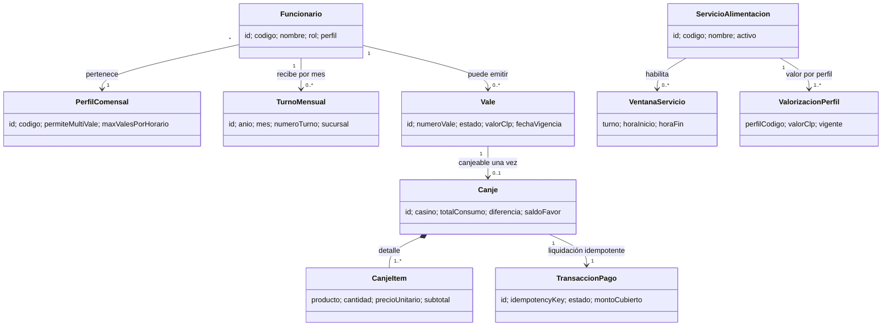
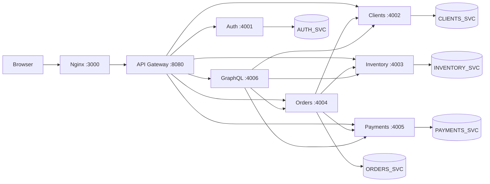

# Informe de arquitectura y backend seguro · Unidad 2

**Caso:** Caso 18 — Sistema de Emisión y Control de Vales de Alimentación (Libros Impresos S.A.)
**Entrega acumulativa:** Entrega 1 (prototipo y frontend) + backend Oracle/.NET.
**Stack que exige el caso:** ambiente web, Oracle y lenguaje orientado a objetos.
**Stack activo:** .NET 10/C#, ASP.NET Core, Oracle Database Free 23.26.4, Hot Chocolate GraphQL, Docker Compose.

Este informe describe los artefactos ejecutables de `Entrega-2`. Los resultados de ejecución se encuentran en [`evidencias/entrega-2/`](evidencias/entrega-2/). `main` y `Entrega-1` conservan su historial Node/PostgreSQL previo; no se utiliza como el backend activo de esta entrega.

## Módulo 1 — Servicios derivados de pantallas y contratos

Los contratos externos se publican mediante `/api/v1`; el cliente no conoce direcciones privadas. Todos los DTO se validan en servidor. Las tarifas, estados de sesión, reglas horarias, titularidad y liquidación son autoridad del backend.

| ID | Pantalla / operación | Contrato | Entrada y resultado principal | Acceso / regla |
| --- | --- | --- | --- | --- |
| S01 | P01 catálogo público | `GET /api/v1/public/products?available=true` | `200 { products: [{id,codigo,nombre,categoria,precioClp,disponible}] }` | Anónimo; solo campos de catálogo |
| S02 | P01 / P02 sucursales | `GET /api/v1/public/branches` | `200 { branches: [...] }` | Anónimo, datos operativos no personales |
| S03–S05 | P01 sesión | `POST /api/v1/auth/login`, `/refresh`, `/logout` | Login entrega access/refresh; refresh rota token; logout revoca sesión | Credenciales siempre del lado servidor; contraseña con PBKDF2 |
| S08–S15 | P02 / P04 clientes | `GET /api/v1/clients/employees/me`, `GET/POST /employees`, `PUT /employees/{id}/shift`, `GET/POST/PUT /profiles` | Perfil, personalización, turnos | RBAC en servicio; empleado solo obtiene su ficha, admin gestiona |
| S16–S23 | P02 / P03 / P04 inventory | `GET/POST/PUT /api/v1/inventory/services`, `/valuations`, `/products` | Servicios, ventanas, valorización, catálogo y disponibilidad | Consulta autenticada; mutación admin; cotización interna usa precio oficial |
| S24–S31 | P02 / P04 orders | `GET /orders/vouchers/my`, listados, emisión adicional, impresión y anulación | Estado auditable de vales | Titularidad, turno, horario, unicidad/idempotencia y transiciones |
| S28 | P02 emisión normal | `POST /api/v1/orders/vouchers/issue` | Código de servicio, sucursal; `201 { voucher, elapsedMs }` | Funcionario; valida servicio/horario/perfil/cupo; no acepta monto cliente |
| S32 | P03 canje | `POST /api/v1/orders/vouchers/{numero}/redeem` | Casino, IDs de producto, cantidades y medio de pago | Cajero; `orders` solicita cotización autoritativa a `inventory`, liquida en `payments` y persiste el canje |
| S33–S38 | P03 / P04 auditoría y pagos | `GET /orders/reports/audit`, `/payments/transactions`, `/reconciliation`; `POST /reconciliation/close`, `/notifications/weekly/run`; `GET /notifications/weekly` | Resúmenes, cierres, avisos | Auditoría/cierre: admin; cajero: transacciones propias |
| S39 | P02 / P04 agregado | `POST /api/v1/graphql` | `miResumenComensal`, `detalleVale`, `panelAuditoria`, `catalogoCasino` | Sesión verificada; acceso por rol/titular y límites de consulta |

Las rutas detalladas y su forwarding están en `backend/Libros.Api/GatewayModule.cs`. Los DTO del navegador no contienen modelos de persistencia ni contraseñas hash.

## Módulo 2 — Clases de dominio y cardinalidades

La restricción única de `REDEMPTIONS.VOUCHER_ID` evita canjes dobles; `VOUCHERS.IDEMPOTENCY_KEY` restringe reemisiones duplicadas del mismo beneficiario/servicio/fecha. Los visitantes pueden tener `EMPLOYEE_ID` nulo y quedan registrados con su beneficiario. Las tablas de cada dominio y sus claves/checks están declaradas en `db/oracle/01-create-users.sql`.

## Módulo 3 — Sistemas e integraciones

| Sistema | Autoridad / datos | Dependencias principales |
| --- | --- | --- |
| `auth-service` | `AUTH_SVC`: cuenta, hash de contraseña, sesión, refresh hash y revocación | Oracle; emite y verifica JWT |
| `clients-service` | `CLIENTS_SVC`: funcionarios, perfil, sucursal, casinos y turno mensual | Oracle; vincula una cuenta de auth al crear funcionario |
| `inventory-service` | `INVENTORY_SVC`: servicios, ventanas, tarifas y productos/precios oficiales | Oracle; respuesta de cotización para `orders` |
| `orders-service` | `ORDERS_SVC`: emisión, impresión, anulación y ciclo del vale; ítems del canje | Oracle, `clients`, `inventory`, `payments` |
| `payments-service` | `PAYMENTS_SVC`: transacciones idempotentes, rendiciones y avisos | Oracle; SP usa privilegios `SELECT` explícitos a clientes/vales; adaptador de correo sandbox o API HTTP |
| `graphql-gateway` | Sin tablas propias; compone datos de varios dominios | REST interno a clients/inventory/orders/payments |
| `gateway` | Sin acceso de base de datos; superficie HTTP pública | auth verify y forwarding por allowlist |

Los servicios se despliegan como contenedores/procesos separados a partir de una imagen .NET común; cada proceso recibe solo las rutas de su módulo y una cuenta Oracle de su propietario. `private_net` no publica puertos al host. Los únicos puertos host son Nginx `3000` y API Gateway `8080`.

## Módulo 4 — Stakeholders y autorización

| Identidad | Acceso concedido | Condición aplicada en backend |
| --- | --- | --- |
| Anónimo | Login y GET catálogo/sucursales | El gateway enruta únicamente las rutas públicas expresas |
| `FUNCIONARIO` | Su ficha, sus vales, emisión, impresión propia | `clients` y `orders` verifican `userId` y estado |
| `CAJERO` | Catálogo, consulta de vale y canje; sus transacciones | El servicio valida estado/rol; precios/totales del cliente se rechazan |
| `ADMINISTRADOR` | Gestión de perfiles, empleados, servicios/tarifas/productos, adicionales, auditoría, cierres/avisos | Cada operación sensible exige rol admin en su microservicio |
| Gateway / servicios técnicos | Comunicación interna específica | Tokens distintos por servicio; validación constante-tiempo |
| Gerencia/contabilidad/auditoría del caso | Supervisión sin permisos operativos | Reciben reportes; no se otorga cuenta de ejecución |

Los encabezados `x-user-id`, `x-user-code`, `x-user-role` y `x-internal-service-token` del navegador no se propagan. El gateway verifica el access token y reconstruye el contexto. Las verificaciones de propiedad y las reglas del negocio permanecen en el microservicio.

## Módulo 5 — API Gateway y fronteras de confianza

Se utiliza un API Gateway público y GraphQL Gateway privado. El gateway acepta una lista fija de prefijos de ruta, valida identity/session contra auth, limita solicitudes (por IP y ventana fija), genera/propaga `X-Correlation-ID`, elimina cabeceras internas del cliente y aplica timeout upstream. Los microservicios no publican puertos. La respuesta pública no incluye stack traces.

El Gateway es un reverse proxy de rutas allowlisted: auth, clients, inventory, orders, payments, GraphQL y catálogo público. Una ruta desconocida responde `404 ROUTE_NOT_FOUND`; no hay proxy genérico configurable por el navegador.

## Módulo 6 — Secretos e integración

| Referencia | Consumidor | Ubicación/restricción |
| --- | --- | --- |
| `ORACLE_SYSTEM_PASSWORD` | Inicialización del contenedor Oracle | Solo el contenedor Oracle; no se publica su puerto |
| `*_DB_PASSWORD` | Servicio propietario del esquema | Variables locales Docker/`.env` ignorado por Git; cuentas `*_SVC` distintas |
| `JWT_SECRET` | `auth-service` | Solo Auth; access/refresh incluyen tipo, expiración y sesión |
| `INTERNAL_TOKEN_AUTH/CLIENTS/INVENTORY/ORDERS/PAYMENTS/GRAPHQL` | Gateway o servicio consumidor específico | Tokens distintos por destino, mínimo privilegio, jamás enviados al browser |
| `EMAIL_API_KEY`, `EMAIL_API_URL` | `payments-service` con modo `http` | Referencias externas; modo default `sandbox`; valor vacío en plantilla |

Solo se documentan referencias simbólicas. No incluyas valores reales en Markdown, imágenes, logs o commits. Para rotar un password de esquema en el primer inicio, cambia tanto `.env` como su usuario en `db/oracle/01-create-users.sql` y recrea el volumen.

## Módulo 7 — Datos personales y credenciales

- `RUT`, correo y ficha de funcionario: restringidos, custodiados por `CLIENTS_SVC`; la API sólo expone su titular o un admin.
- Hash de contraseña: sólo en `AUTH_SVC`; PBKDF2-HMAC-SHA256, 210.000 iteraciones, sal aleatoria de 16 bytes y comparación de tiempo constante.
- Access token expira a los 15 minutos; refresh a los 7 días, se rota y sólo se almacena su hash. Cerrar sesión revoca la fila persistida.
- La orden/canje no confía en el precio ni el monto del browser; un request con campos no definidos recibe `400` por rechazo de propiedades JSON no mapeadas.
- Los registros de evidencia del smoke test omiten credenciales/tokens y no agregan datos personales.

## Módulo 8 — Microservicios privados y GraphQL

`miResumenComensal` compone una ficha propia de `clients`, horarios y tarifas de `inventory`, vales de `orders` y avisos de `payments`. `panelAuditoria` exige administrador y combina órdenes con rendiciones de pagos. Los fallos secundarios se devuelven en `partialErrors` sin afirmar que el panel está completo. Las llamadas son por subsistema/lista, no por cada fila de UI, lo que evita N+1 en este flujo.

El gateway GraphQL privado limita anidamiento a profundidad 4, alias a 40 y complejidad aproximada a 500; la query depth-five y alias masivos tienen pruebas de rechazo. La ficha agregada contiene los datos de la identidad actual; detalle de vale aplica el control de titularidad del `orders-service`.

## Módulo 9 — ADR aplicabilidad de analítica y gRPC

**ADR-001 (vigente): sin servicio de big data separado ni gRPC.** Caso 18 proyecta del orden de 2.000 vales al día tras duplicar la dotación; las operaciones son CRUD/transacciones discretas, no un flujo de telemetría o streaming. Oracle indexado y el procedimiento PL/SQL semanal son suficientes en este laboratorio. GraphQL integra HTTP REST privado. La suite de Unidad 2 valida el flujo/RF2 de forma funcional, pero la medición de una muestra no equivale a una prueba de carga ni acredita p95 productivo.

Si la carga, el volumen de informes, el streaming o la telemetría cambian, el ADR debe reevaluarse con mediciones antes de introducir gRPC/analítica.

## Módulo 10 — Ejecución, persistencia y validación

La solución compila con `dotnet build backend/LibrosBackend.slnx --no-restore`; `docker compose config --quiet` valida la orquestación. La prueba reproducible está en `tests/oracle/entrega2-smoke.mjs` y se ejecuta con `tests/oracle/run-entrega2-tests.ps1` tras restablecer Oracle. Cubre consultas anónimas, login, sesiones/revocación, roles, IDOR, GraphQL, límites, creación de perfiles/funcionarios/productos/servicios, turnos, emisión normal, duplicado, canje y cálculo de pago en el servidor, avisos PL/SQL sandbox, auditoría y agregación.

La corrida estable de `summary.json` con `passed=22, failed=0` está en [`evidencias/entrega-2/RUN_UNIT2_2026-11-28T03-05-06-867Z/`](evidencias/entrega-2/RUN_UNIT2_2026-11-28T03-05-06-867Z/summary.json). La vista de administración real también se recorrió desde navegador headless: creó producto y funcionario (incluyendo cuenta Auth) desde la SPA, con capturas en `evidencias/entrega-2/ui-admin-*.png` y reporte [`ui-admin-report.json`](evidencias/entrega-2/ui-admin-report.json). Estas son ejecuciones locales/emuladas con Oracle y datos ficticios; **no** prueban hardware real, SMTP entregable, WAN, cloud, biometría ni concurrencia de producción. La validación de flujos completos del tótem y caja desde navegador, escenarios de recuperación/regresión y las conclusiones por requisito se completan como parte de la Entrega 3.

### Limitaciones vigentes declaradas

1. Correo: `sandbox` valida procedimiento, persistencia y contrato. El adaptador `EMAIL_PROVIDER_MODE=http` permite API externa, pero interoperabilidad exige URL/clave sandbox/productiva del proveedor.
2. Las métricas `elapsedMs` reflejan la operación de emisión en la corrida; falta caracterización de throughput/p95/cpu/memoria a una carga definida.
3. No se implementa autenticación biométrica/tarjetas; el Caso 18 la deja para una etapa futura.
4. El proceso de servicios comparte una imagen/ensamblado .NET por `SERVICE_KIND`; límites de contenedor, Oracle users, red y contratos sí están separados.
