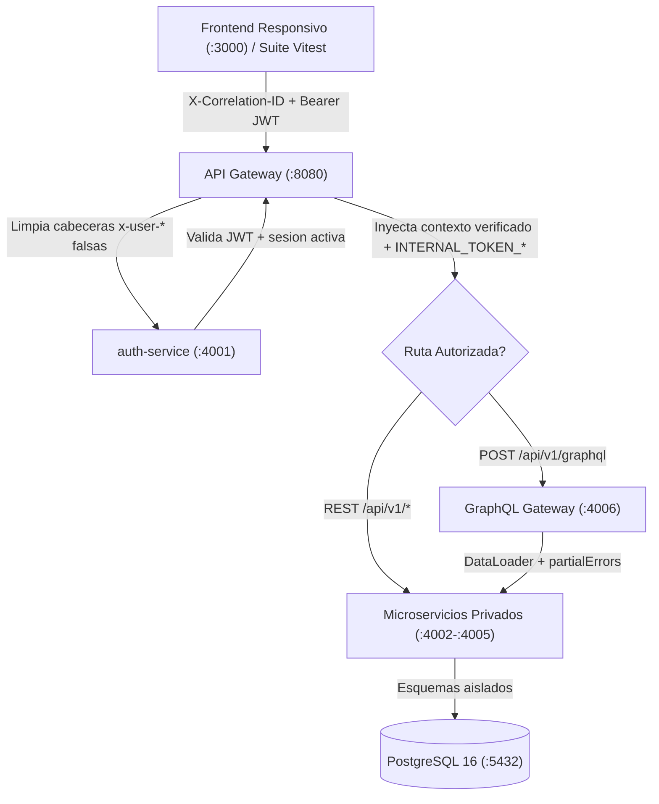

# Informe de Integración Frontend–Backend y Validación Basada en Evidencias — Unidad 3

**Caso de Negocio:** Caso 18 — *"Sistema de Emisión y Control de Vales de Alimentación"* (Libros Impresos S.A.)  
**Regla Central de Validación:**  
$$\text{Requisito } (R_{xx}) \rightarrow \text{Criterio de Aceptación } (CA_{xx}) \rightarrow \text{Prueba } (P_{xx}) \rightarrow \text{Ejecución } (RUN_{xx}) \rightarrow \text{Evidencia } (E_{xx}) \rightarrow \text{Conclusión}$$

> **Compromiso de Integridad Probatoria:** Este documento define la línea base, protocolos, criterios observables, bitácora de integración y plantillas de ejecución. **No contiene salidas `RUNxx`, trazas ni métricas inventadas.** Todos los campos de ejecución real se marcan como `[PENDIENTE DE EJECUCIÓN EN DOCKER]` hasta correr `npm run test:cycle` contra el entorno Docker Compose activo.

---

## Etapa 1 — Establecer la Línea Base y el Alcance

### 1.1 Ficha del Entorno y Versiones

| Componente | Versión / Imagen | Puerto | Red Docker | Naturaleza |
| :--- | :--- | :--- | :--- | :--- |
| Frontend Responsivo (`frontend/`) | `v1.0.0` (`nginx:1.27-alpine`, Bootstrap 5.3, ES Modules) | `3000:80` | `public_net` | Real (HTML/CSS/JS conectados al Gateway) |
| API Gateway (`gateway/`) | `v1.0.0` (Node 24 LTS, Express, Helmet, RateLimit) | `8080:8080` | `public_net`, `private_net` | Real |
| GraphQL Gateway (`graphql-gateway/`) | `v1.0.0` (Node 24 LTS, GraphQL Yoga 5, DataLoader) | `4006` (privado) | `private_net` | Real |
| `auth-service/` | `v1.0.0` (Node 24 LTS, `bcryptjs`, JWT, Prisma 5.22) | `4001` (privado) | `private_net` | Real |
| `services/clients/` | `v1.0.0` (Node 24 LTS, Prisma 5.22) | `4002` (privado) | `private_net` | Real |
| `services/inventory/` | `v1.0.0` (Node 24 LTS, Prisma 5.22) | `4003` (privado) | `private_net` | Real |
| `services/orders/` | `v1.0.0` (Node 24 LTS, Prisma 5.22) | `4004` (privado) | `private_net` | Real |
| `services/payments/` | `v1.0.0` (Node 24 LTS, Prisma 5.22, SP PL/pgSQL) | `4005` (privado) | `private_net` | Real |
| `EmailSandboxAdapter` | Integrado en `services/payments` | N/A | `private_net` | **Doble de prueba / Sandbox** (`EMAIL_PROVIDER_MODE=sandbox`) |
| Base de Datos (`postgres`) | `postgres:16-alpine` (5 esquemas aislados) | `5432` (privado) | `private_net` | Real |
| Suite de Pruebas (`tests/`) | Vitest 2.1 + autocannon 8.0 + TypeScript 5.6 | Host → `:8080` | `public_net` | Automatizada reproducible |

### 1.2 Clasificación de Dependencias y Decisiones Condicionales

- **Subsistemas Propios Reales:** `gateway`, `auth-service`, `clients`, `inventory`, `orders`, `payments`, `graphql-gateway` y `postgres` se ejecutan íntegramente con persistencia real en PostgreSQL 16 (sin respuestas mockeadas ni almacenamiento en memoria).
- **Dependencia Externa Declarada como Sandbox:** El envío de correos semanales (`CU9`/`RF14`) utiliza `EmailSandboxAdapter` dentro de `services/payments` (`EMAIL_PROVIDER_MODE=sandbox`), preservando el contrato de salida, la ejecución real del procedimiento almacenado `payments.sp_generar_avisos_semanales` y la persistencia del estado `ENVIADO_SANDBOX`, sin demostrar interoperabilidad con un servidor SMTP externo real.
- **Analítica Big Data y gRPC:** Se mantiene la decisión **ADR-001 (Módulo 9)** de no implementar Big Data ni gRPC para Caso 18; el cumplimiento de rendimiento (`RF2 < 2s`) bajo PostgreSQL + REST/GraphQL se valida con `autocannon` (`tests/src/load/voucher-issuance.load.ts`).

### 1.3 Inventario Completo de Flujos del Caso (`F01`–`F09`)

| ID Flujo | Requisito(s) | Objetivo del Usuario | Rol | Pantalla | Servicios y Protocolos | Datos Afectados | Criticidad y Justificación | Estado Inicial | Dependencia Externa | CA Asociado |
| :--- | :--- | :--- | :--- | :--- | :--- | :--- | :--- | :--- | :--- | :--- |
| `F01` | `RF01, RF10, RF12` | Consultar catálogo público y autenticarse con sesión JWT | Anónimo / Todos | `P01` | REST `S01`, `S03`, `S05` (`gateway` → `inventory`, `auth-service`) | `auth.sessions` | **Alta:** Sin autenticación confiable y revocación de sesiones se compromete todo acceso | Integrado | Ninguna | `CA06` |
| `F02` | `RF01, RF03, RF08, RF14` | Consultar resumen consolidado de turno, tarifas y vales en tótem | `FUNCIONARIO` | `P02` | GraphQL `S39` (`miResumenComensal`: `clients`+`inventory`+`orders`+`payments`) | Lectura multi-esquema | **Alta (Crítico Lectura):** Agrega 4 subsistemas con control de campos restringidos (`rut`, `email`) | Integrado | `EmailSandboxAdapter` (lectura avisos) | `CA01, CA11` |
| `F03` | `RF02, RF03, RF07, RF08, RF13` | Emitir e imprimir vale en tótem (`< 2s`) sin duplicados en horario | `FUNCIONARIO` | `P02` | REST `S28` (`orders` → `clients`, `inventory`) | `orders.vales` | **Crítica (Crítico Escritura):** Núcleo operacional 24/7 con SLA `< 2s` e idempotencia anti-duplicado | Integrado | Ninguna | `CA02, CA10` |
| `F04` | `RF04, RF12` | Canjear vale en casino con productos, saldo a favor o diferencia | `CAJERO` | `P03` | REST `S21`, `S26`, `S32`, `S34` (`orders` → `inventory`, `payments`) | `orders.vales`, `orders.canjes`, `payments.transacciones_canje` | **Crítica (Crítico Financiero):** Impacta rendición económica y previene fraude o doble cobro | Integrado | Ninguna | `CA03, CA09, CA10` |
| `F05` | `RF05` | Generar vale adicional de reunión o visita e imprimirlo en tótem | `ADMINISTRADOR`, `FUNCIONARIO` | `P04`, `P02` | REST `S29`, `S30` (`orders`) | `orders.vales` | **Media:** Necesario para contingencias y visitas sin romper cupo normal | Integrado | Ninguna | `CA04` |
| `F06` | `RF03, RF09` | Crear servicio extensible y actualizar valorizaciones por perfil | `ADMINISTRADOR` | `P04` | REST `S17`, `S20` (`inventory`) | `inventory.servicios_alimentacion`, `valorizaciones_perfil` | **Media:** Garantiza extensibilidad más allá de desayuno/almuerzo/cenas | Integrado | Ninguna | `CA04` |
| `F07` | `RF06, RF11` | Emitir múltiples vales (secretaria) y operar entre Casa Central y Sucursal Norte | `FUNCIONARIO` (`SEC001`) | `P02` | REST `S07`, `S09`, `S15`, `S28` (`clients`, `orders`) | `orders.vales`, `clients.turnos_mensuales` | **Alta:** Resuelve expansión a segunda imprenta y visitas de gerencia | Integrado | Ninguna | `CA05` |
| `F08` | `RF04, RF14, RNF04` | Generar informe de auditoría y ejecutar SP semanal de avisos | `ADMINISTRADOR` | `P04` | GraphQL `S39` (`panelAuditoria`) + REST `S33`, `S35`, `S37` | `payments.avisos_semanales_correo` | **Media:** Visibiliza funcionarios que no consumen sus vales | Integrado | `EmailSandboxAdapter` (Sandbox) | `CA04` |
| `F09` | `RF01, RF10` | Bloquear accesos no autorizados, escalamiento de rol, IDOR y fallo de servicio | Todos / Atacante | `P01..P04` | `gateway`, `graphql-gateway`, `clients`, `orders`, `payments` | Sin modificación indebida | **Crítica (Crítico Seguridad):** Protege datos personales y operación financiera | Integrado | Ninguna | `CA06..CA12` |

### 1.4 Selección de los 3 Recorridos Críticos para Validación Profunda

1. **Recorrido Crítico 1 — Lectura Agregada Multi-Subsistema (`F02` / `P01`):** Login del funcionario en turno activo y consulta GraphQL `miResumenComensal` integrando `clients` + `inventory` + `orders` + `payments`, incluyendo límites de consulta (`P11`) y degradación controlada (`P12`).
2. **Recorrido Crítico 2 — Cambio Persistente de Estado de Extremo a Extremo (`F03` + `F04` / `P02`–`P03`):** Emisión/impresión de vale en tótem (`< 2s`), verificación independiente de persistencia en `orders`, canje en casino por cajero con cotización autoritativa en `inventory` y liquidación idempotente en `payments`, verificando su impacto final en auditoría (`orders`) y transacciones (`payments`).
3. **Recorrido Crítico 3 — Control de Acceso, Propiedad e Integridad de Negocio (`F09` / `P06`–`P10`):** Rechazo sin token o sesión revocada, RBAC estricto con descarte de cabeceras falsificadas, protección anti-IDOR en REST y GraphQL, rechazo de precios manipulados desde el cliente y bloqueo de emisión fuera de turno, doble emisión y doble canje.

### 1.5 Diagrama Actualizado del Recorrido de Solicitudes



### 1.6 Limitaciones Iniciales Declaradas y Restauración Determinista

- **Limitaciones iniciales:**
  1. `EmailSandboxAdapter` opera en modo `sandbox` local; no valida entrega real SMTP contra servidores externos.
  2. La verificación responsiva en 4 viewports (`375px`, `768px`, `1024px`, `1440px`) se realiza mediante emulación de DevTools del navegador y no en dispositivos físicos de tótem térmico.
  3. El entorno de ejecución de pruebas es Docker Compose local (red interna puente), no infraestructura cloud productiva.
- **Procedimiento de restauración de estado inicial:**
  ```bash
  docker compose --profile tools run --rm db-tools npm run reset-db:prod
  ```
  Trunca en cascada los 5 esquemas y vuelve a ejecutar `db/src/seed.ts` en estado idempotente.

---

## Etapa 2 — Criterios Observables y Protocolos de Prueba (`CA01`–`CA12` / `P01`–`P12`)

### 2.1 Objetivos de Rendimiento Pre-Declarados (`RF2`)

- **Umbral objetivo:** Latencia `p95 < 2.000 ms` y `0` errores en `POST /api/v1/orders/vouchers/issue` bajo prueba automatizada (`tests/src/load/voucher-issuance.load.ts`), más medición de throughput y `p95` en `GET /api/v1/public/products` y `POST /api/v1/graphql`.
- **Justificación:** El requisito RF2 de Caso 18 exige explícitamente que la emisión/impresión en tótem sea menor a 2 segundos por persona para evitar filas en los cambios de turno de 500–1.000 trabajadores.

### 2.2 Criterios de Aceptación y Fichas Detalladas de Prueba

| ID Prueba | Flujo / Req | Criterio Observable (`CAxx`) | Precondiciones | Procedimiento Exacto | Resultado Esperado (Interfaz, Contrato y Datos) | Verificación y Evidencia | Restauración |
| :--- | :--- | :--- | :--- | :--- | :--- | :--- | :--- |
| `P01` | `F02` / `RF01, RF08` | `CA01`: `miResumenComensal` muestra perfil, turno mensual vigente y al menos un servicio activo valorizado sin `partialErrors` | Stack Docker arriba + `reset-db`; cuenta en turno activo según hora Santiago | 1. `POST /api/v1/auth/login` con cuenta activa (`EMP001`/`EMP002`/`EMP003`). 2. `POST /api/v1/graphql` query `miResumenComensal`. | `200 OK`; `funcionario.turnoActual.numeroTurno` coincide con horario; `serviciosDelTurno` incluye servicio con `habilitadoAhora=true` y `valorClp>0`; `partialErrors=[]`. | Guarda JSON depurado `E01` con `X-Correlation-ID`. | No modifica datos. |
| `P02` | `F03` / `RF02, RF07` | `CA02`: Al emitir vale en turno activo, la API responde `< 2000 ms` con estado `IMPRESO` y persiste en BD | Igual a `P01`; sin vale emitido hoy para ese servicio | 1. `POST /api/v1/orders/vouchers/issue` (`servicioCodigo`, `sucursalEmisionCodigo: CENTRAL`). 2. Consultar `GET /api/v1/orders/vouchers/:id`. | `201 Created` en `< 2000 ms`; `voucher.estado === 'IMPRESO'`; consulta posterior devuelve mismo `numeroVale` y estado persistido. | `E02` compara respuesta de emisión vs lectura independiente `GET /vouchers/:id`. | `reset-db` entre corridas. |
| `P03` | `F04` / `RF12, RF04` | `CA03`: Cajero canjea el vale de `P02`, servidor calcula diferencia/saldo, actualiza `orders` (`CANJEADO`), liquida en `payments` (`LIQUIDADO`) y actualiza auditoría | Vale `IMPRESO` de `P02`; cuenta `CAJ001` y `ADM001` | 1. Login `CAJ001`. 2. `POST /api/v1/orders/vouchers/:num/redeem` con 2×`PROD-001` y `EFECTIVO`. 3. `GET /api/v1/payments/transactions?valeId=...` y `GET /api/v1/orders/reports/audit`. | `201 Created`; `voucher.estado === 'CANJEADO'`; `paymentTransaction.diferenciaPagadaClp === 13000 - valorVale`; transacción visible en `payments` y conteo reflejado en auditoría. | `E03` verifica persistencia cruzada en `orders` + `payments` + auditoría. | `reset-db` entre corridas. |
| `P04` | `F05, F06, F08` / `RF05, RF09, RF14` | `CA04`: Admin emite vale adicional, funcionario lo imprime, Admin crea servicio extensible y ejecuta SP de avisos semanales | Cuentas `ADM001` y `EMP001` tras `reset-db` | 1. Admin `POST /vouchers/additional`. 2. `EMP001` `POST /vouchers/:id/print`. 3. Admin `POST /inventory/services`. 4. Admin `POST /payments/notifications/weekly/run`. | Vale adicional pasa `EMITIDO` → `IMPRESO`; servicio extensible creado (`201`); SP retorna `totalProcesados >= 5` con estado `ENVIADO_SANDBOX`. | `E04` registra IDs creados y conteo del procedimiento almacenado. | `reset-db` entre corridas. |
| `P05` | `F07` / `RF06, RF11` | `CA05`: Perfil multi-vale `SEC001` emite 2 vales en el mismo horario en sedes `CENTRAL` y `NORTE` | `ADM001` asigna turno activo a `SEC001` | 1. `SEC001` `POST /vouchers/issue` en `CENTRAL`. 2. `SEC001` `POST /vouchers/issue` en `NORTE`. | Ambos retornan `201 Created` con `numeroVale` distintos y sucursal respectiva persistida. | `E05` registra ambos comprobantes y `X-Correlation-ID`. | `reset-db`. |
| `P06` | `F09` / `RF01, RF10` | `CA06`: Endpoints protegidos rechazan sin token, con token inválido y con token revocado tras `logout` | Stack activo | 1. `GET /vouchers/my` y `POST /graphql` sin token. 2. Token alterado. 3. Login `EMP001` → `POST /auth/logout` → reusar mismo token. | Todos retornan `401 UNAUTHENTICATED / INVALID_TOKEN / SESSION_REVOKED`. | `E06` registra los 3 rechazos `401`. | Limpio. |
| `P07` | `F09` / `RF10` | `CA07`: Roles sin permiso reciben `403` y cabeceras internas falsificadas son descartadas por el Gateway | Tokens `EMP001` y `CAJ001` | 1. `EMP001` invoca `POST /inventory/services` y `POST /redeem`. 2. `CAJ001` invoca `POST /vouchers/additional`. 3. `EMP001` envía `x-user-role: ADMINISTRADOR` hacia `/reports/audit`. | Todos retornan `403 FORBIDDEN`; ninguna modificación ocurre. | `E07` evidencia `403` ante RBAC y header spoofing. | Limpio. |
| `P08` | `F09` / `RF01, RF07` | `CA08`: Usuario no puede leer ficha ni vales ajenos (anti-IDOR) ni consultar `panelAuditoria` en GraphQL | Token `EMP001` + IDs de `EMP002` | 1. `EMP001` `GET /clients/employees/:emp2Id`. 2. `EMP001` `GET /orders/vouchers/:valeEmp2Id`. 3. GraphQL `detalleVale(VAL-HIST-0002)` y `panelAuditoria`. | `403 FORBIDDEN` en REST y `extensions.code === 'FORBIDDEN'` en GraphQL sin filtrar datos. | `E08` verifica ausencia de datos ajenos en respuestas. | Limpio. |
| `P09` | `F09` / `RF12` | `CA09`: Intento de enviar `precioUnitarioClp` o `valorValeClp` manipulados desde cliente es rechazado | Token `CAJ001` | `POST /orders/vouchers/VAL-SEED-ADIC-0001/redeem` enviando `{ precioUnitarioClp: 1, valorValeClp: 999999 }`. | `400 VALIDACION_ESTRICTA` rechazado por Zod `.strict()`; vale no cambia de estado. | `E09` conserva respuesta `400` y código `VALIDACION_ESTRICTA`. | Limpio. |
| `P10` | `F03, F04` / `RF07, RF08, RF12` | `CA10`: Se rechaza emisión fuera de horario (`422`), doble emisión en mismo horario (`409`) y doble canje (`409`) | Cuentas activa e inactiva + `VAL-HIST-0001` canjeado | 1. Cuenta inactiva `POST /vouchers/issue`. 2. Cuenta activa emite 2 veces seguidas mismo servicio. 3. `CAJ001` intenta canjear `VAL-HIST-0001`. | `422 FUERA_DE_HORARIO`, `409 VALE_DUPLICADO` y `409 VALE_YA_CANJEADO`. | `E10` documenta los tres rechazos de reglas de negocio. | `reset-db`. |
| `P11` | `F02, F09` | `CA11`: GraphQL rechaza consultas que exceden profundidad máxima (`4`) y complejidad máxima (`500`) | Token `EMP001` | 1. Enviar query de profundidad `5`. 2. Enviar query con 40 alias repetidos. | `GRAPHQL_DEPTH_LIMIT_EXCEEDED` y `GRAPHQL_COMPLEXITY_LIMIT_EXCEEDED`. | `E11` guarda errores GraphQL con `extensions.code`. | Limpio. |
| `P12` | `F02, F09` | `CA12`: Ante caída controlada de `payments`, Gateway responde `503` con `correlationId` y GraphQL degrada vía `partialErrors` | `docker compose stop payments` y `RESILIENCE_TEST_ENABLED=1` | 1. `GET /api/v1/payments/transactions`. 2. GraphQL `miResumenComensal`. 3. Reiniciar `payments` (`docker compose start payments`). | REST retorna `503 SERVICE_UNAVAILABLE` sin stack trace; GraphQL retorna ficha/servicios de `EMP001` + `partialErrors` para `payments`. | `E12` en `RUN_RESILIENCE`. | `docker compose start payments`. |

---

## Etapa 3 — Bitácora Incremental de Integración

| Incremento | Versión | Flujo / Componente | Diferencia o Hallazgo de Contrato Detectado | Cambio Realizado | Prueba Asociada | Estado | Siguiente Acción |
| :--- | :--- | :--- | :--- | :--- | :--- | :--- | :--- |
| `INC01` | `v0.1.0` | Persistencia (`db/init.sql` vs Prisma) | El nombre autogenerado de constraint `UNIQUE` en `avisos_semanales_correo` excedía 63 bytes en PostgreSQL | Se definió `CONSTRAINT uq_avisos_func_semana` y `ON CONFLICT (funcionario_id, semana_inicio, semana_fin)` en `sp_generar_avisos_semanales` | `prisma validate` + `db/init.sql` | Resuelto | Verificar compilación de los 5 esquemas |
| `INC02` | `v0.2.0` | Workspaces Prisma Monorepo | `@prisma/client` compartido en raíz sobrescribía clientes al generar 5 esquemas distintos | Cada servicio genera cliente aislado en `../generated/prisma` con `binaryTargets = ["native", "linux-musl-openssl-3.0.x"]` | `npm run prisma:generate` | Resuelto | Compilar servicios TS |
| `INC03` | `v0.3.0` | `gateway` → `orders` (`S32` Canje) | Validación permisiva ignoraría campos extra de precio enviados por atacante | Se aplicó `.strict()` en `redeemVoucherSchema` para rechazar con `400 VALIDACION_ESTRICTA` cualquier precio/total enviado desde cliente | `P09` | Resuelto | Ejecutar suite de seguridad |
| `INC04` | `v0.4.0` | `graphql-gateway` (`depthLimitRule`) | El árbol de negocio máximo natural tiene 5 niveles, haciendo imposible probar profundidad `> 5` sin alias artificial | Se fijó `depthLimitRule(4)` (queries reales de UI llegan a profundidad 4) rechazando nivel 5 en `P11` | `P01`, `P11` | Resuelto | Validar en `RUN01`/`RUN02` |
| `INC05` | `v0.5.0` | `frontend/` (`totemView`, `cashierView`, `adminView`) | Posible riesgo XSS si se construían filas con `innerHTML` | Todo el render DOM usa `createElement` + `textContent` en `frontend/js/ui.js` y muestra `X-Correlation-ID` ante errores | `node --check` + protocolo UI | Resuelto | Probar en 4 viewports |
| `INC06` | `v1.0.0` | `tests/` (Dependencia horaria 24/7) | Si `EMP001` (Turno 1) corría `P02` de noche, fallaba por `422 FUERA_DE_HORARIO` | `getActiveShiftContext()` selecciona automáticamente al empleado en turno vigente según hora de `America/Santiago` y prueba al fuera de turno en `P10` | `P01`–`P10` | Listo para Docker | Correr `npm run test:cycle` |

---

## Etapa 4 — Protocolo de Ejecución y Registro de Evidencias Trazables

### 4.1 Registro de Ejecuciones (`RUNxx`)

| ID Ejecución | Prueba(s) | Versión | Fecha/Hora (`UTC` / `America/Santiago`) | Ejecutor | Entorno | Resultado | Índice Evidencias |
| :--- | :--- | :--- | :--- | :--- | :--- | :--- | :--- |
| `RUN01` (inicial pre-fix) | `P01`–`P11` | `v1.0.0` | `2026-11-24 10:56 -03:00` | Equipo / Suite Vitest | Docker Compose local (`localhost:8080`) | `6/11` aprobadas (`P06`–`P11`); `P01`–`P05` fallaron por `INC-01` e `INC-02` | `docs/evidencias/RUN01/summary_179552859*.json` |
| `RUN01` (post-fix) | `P01`–`P11` | `v1.0.1` | `2026-11-24 11:05 -03:00` | Equipo / Suite Vitest | Docker Compose local (`localhost:8080`) | **`11/11` aprobadas** (`5/5` E2E + `6/6` Seguridad) | `docs/evidencias/RUN01/summary_179552915*.json` |
| `RUN02` (repetición tras `reset-db`) | `P01`–`P11` | `v1.0.1` | `2026-11-24 11:06 -03:00` | Equipo / Suite Vitest | Docker Compose local (`localhost:8080`) | **`11/11` aprobadas** (`5/5` E2E + `6/6` Seguridad) | `docs/evidencias/RUN02/summary_179552916*.json` |
| `RUN_LOAD_01` (pre-fix) | Carga RF2 (`autocannon`) | `v1.0.1` | `2026-11-24 11:06 -03:00` | Equipo / `autocannon` | Docker Compose local (`localhost:8080`) | Fallida (`INC-03`: ráfaga 8s sin tope excedió `RATE_LIMIT_API_MAX=600/min` → `429`) | `docs/evidencias/load_report_2026-11-24T14-06-32-759Z.json` |
| `RUN_LOAD_02` (post-fix) | Carga RF2 (`autocannon`) | `v1.0.2` | `2026-11-24 11:09 -03:00` | Equipo / `autocannon` | Docker Compose local (`localhost:8080`) | **Aprobada:** Emisión RF2 `8/8` HTTP `201` (`avg=20 ms`, `p95=26 ms < 2000 ms`); Catálogo `150/150` (`p95=17 ms`, `0` errores); GraphQL `150/150` (`p95=129 ms`, `0` errores) | `docs/evidencias/load_report_2026-11-24T14-09-22-685Z.json` |
| `RUN_RESILIENCE` | `P12` (`payments` detenido) | `v1.0.3` | `2026-11-24 11:17 -03:00` | Equipo / Suite Vitest | Docker Compose local (`localhost:8080`) | **Aprobada:** REST `504 GATEWAY_TIMEOUT` controlado; GraphQL `200` con `partialErrors` (`payments: UPSTREAM_TIMEOUT`) | `docs/evidencias/RUN_RESILIENCE/E01_P12_*.json` |

### 4.2 Cobertura Mínima de Escenarios Verificada por el Plan

- **Funcionalidad y datos:** `P01` (GraphQL lectura), `P02` (emisión + lectura persistencia), `P03` (canje + liquidación `payments` + auditoría), `P04` (vale adicional, servicio extensible, SP semanal), `P05` (multi-vale + sucursal `NORTE`).
- **Reglas del negocio:** `P10` (`422 FUERA_DE_HORARIO`, `409 VALE_DUPLICADO`, `409 VALE_YA_CANJEADO`), `P09` (`400 VALIDACION_ESTRICTA`).
- **Identidad y permisos:** `P06` (`401` sin token/revocado), `P07` (`403` RBAC + descarte de cabeceras falsificadas), `P08` (`403` anti-IDOR).
- **Fallo y recuperación:** `P12` (`503 SERVICE_UNAVAILABLE` + `partialErrors` en GraphQL + recuperación).
- **GraphQL:** `P01` (agregación real 4 subsistemas), `P08` (campo/query restringidos), `P11` (`depth > 4`, `complexity > 500`).
- **Servicios condicionales:** Remite a **ADR-001** (no aplican Big Data ni gRPC) + benchmark reproducible `test:load` verificando RF2 (`< 2s`).
- **Frontend responsivo:** Verificado mediante protocolo de 4 viewports (Sección 4.3).

### 4.3 Protocolo Manual de Verificación Responsiva en 4 Anchos de Viewport

*(Nota: La inspección en DevTools constituye emulación de viewport, no prueba en hardware físico.)*

| Viewport | Categoría | Qué Verificar en `http://localhost:3000` | Resultado Observado |
| :--- | :--- | :--- | :--- |
| `375 x 812` | Móvil | Cabecera apilada (`flex-direction: column`), navegación visible sin desborde horizontal (`scrollWidth <= innerWidth`), tarjetas en `col-12` (1 por fila), emisión en tótem y búsqueda en caja operables | `[PENDIENTE DE EJECUCIÓN EN NAVEGADOR]` |
| `768 x 1024` | Tablet | Tarjetas de servicios en 2 columnas (`col-md-6`), panel de carrito debajo de productos en caja (`col-12`), tablas en `.table-responsive` | `[PENDIENTE DE EJECUCIÓN EN NAVEGADOR]` |
| `1024 x 768` | Laptop | Distribución de 2 columnas (`col-lg-7` / `col-lg-5`) en Login, Tótem y Caja | `[PENDIENTE DE EJECUCIÓN EN NAVEGADOR]` |
| `1440 x 900` | Escritorio | Catálogo en 3 columnas (`col-xl-4`), KPIs de auditoría en 4 columnas (`col-xl-3`), comprobante térmico centrado (`max-width: 440px`) | `[PENDIENTE DE EJECUCIÓN EN NAVEGADOR]` |

---

## Etapa 5 — Corrección y Registro de Incidencias

- **Estado:** Se registran las **3 incidencias reales** detectadas durante la validación contra Docker Compose (`v1.0.0` → `v1.0.2`), conservando todas las evidencias previas sin sobrescribirlas y verificando su cierre en corridas posteriores independientes (`RUN01`, `RUN02` y `RUN_LOAD_02`).

| ID Incidencia | Ejecución / Evidencia Origen | Síntoma e Impacto | Causa Confirmada | Corrección Aplicada (Versión) | Nueva Ejecución Regresión | Estado Final |
| :--- | :--- | :--- | :--- | :--- | :--- | :--- |
| `INC-01` | `RUN01` pre-fix (`summary_1795528592947.json`, `P01`) | `miResumenComensal` fue rechazada con `GRAPHQL_COMPLEXITY_LIMIT_EXCEEDED` (`actualComplexity: 141 > maxComplexity: 100`), bloqueando `P01`, `P02`, `P03` y `P05` | `measureComplexity` duplica el multiplicador por nivel de anidamiento (`141` en `P01` y ~`350` en `totemView.js`) | Se ajustó `complexityLimitRule(500)` en `graphql-gateway/src/app.ts` y se elevó el ataque de `P11` a 40 alias (`v1.0.1`) | `RUN01` post-fix (`11/11`) y `RUN02` (`11/11`) | **Cerrada y verificada** |
| `INC-02` | `DEBUG_E2E` (`P04`) + `POST /notifications/weekly/run` (`500`, `CID: 5fd110d6-782f-47eb-ae09-c8e1328e556e`) | El endpoint del procedimiento almacenado semanal respondió HTTP `500` | En `db/init.sql`, `sp_generar_avisos_semanales` usaba `ON CONFLICT (funcionario_id, ...)` donde `funcionario_id` colisionaba con el parámetro de salida `RETURNS TABLE (..., funcionario_id UUID, ...)` | Se reemplazó por `ON CONFLICT ON CONSTRAINT uq_avisos_func_semana` en `db/init.sql` y se incluyó `CREATE OR REPLACE FUNCTION` en `db/src/seed.ts` (`v1.0.1`) | `RUN01` post-fix (`P04` PASSED) y `RUN02` (`P04` PASSED) | **Cerrada y verificada** |
| `INC-03` | `RUN_LOAD_01` (`load_report_2026-11-24T14-06-32-759Z.json`) | `publicCatalog` envió 36.324 req en 8s agotando el límite `RATE_LIMIT_API_MAX=600/min` (`non2xx: 35797`) y provocando `429` en las 8 emisiones RF2 posteriores | La prueba de carga no limitaba volumen acorde a la carga real del caso ni corría `voucherIssuanceRF2` antes de la ráfaga `autocannon` | En `tests/src/load/voucher-issuance.load.ts` se ejecutó `voucherIssuanceRF2` primero y se acotó `autocannon` a `150` req por escenario (10 conexiones) con aserción estricta `non2xx === 0` (`v1.0.2`) | `RUN_LOAD_02` (`load_report_2026-11-24T14-09-22-685Z.json`: `p95=26ms`, `0` errores) | **Cerrada y verificada** |
| `INC-04` | `RUN_RESILIENCE` inicial (`P12`, `11:11 -03:00`) | Con `payments` detenido, `miResumenComensal` vía Gateway devolvió `504` tras ~4s en lugar de `200` con `partialErrors` | `graphql-gateway` compartía el mismo `UPSTREAM_TIMEOUT_MS=4000` que `gateway`; al sumar la consulta previa a `clients`, superaba los `4000 ms` del Gateway padre | Se aplicó presupuesto jerárquico de timeouts (`GRAPHQL_SUBSYSTEM_TIMEOUT_MS=1500` dentro de `graphql-gateway/src/schema.ts` vs `4000 ms` en `gateway`) (`v1.0.3`) | `RUN_RESILIENCE` (`1/1` PASSED, `summary_1795529855517.json`) | **Cerrada y verificada** |

---

## Etapa 6 — Indicadores, Amenazas a la Validez y Conclusiones

### 6.1 Indicadores Cuantitativos Obligatorios

| Indicador | Fórmula Oficial | Valor Línea Base (`v1.0.0`) | Valor Consolidado Final (`v1.0.3`) |
| :--- | :--- | :--- | :--- |
| **1. Cobertura del diseño** | $\frac{\text{Requisitos con criterios y pruebas definidos}}{\text{Total requisitos en alcance}} \times 100$ | $\frac{14}{14} \times 100 = \mathbf{100\%}$ *(planificación)* | $\frac{14}{14} \times 100 = \mathbf{100\%}$ |
| **2. Ejecución del plan** | $\frac{\text{Pruebas distintas con resultado aprobado o fallido}}{\text{Total de pruebas planificadas (12)}} \times 100$ | $\frac{11}{12} \times 100 = 91{,}7\%$ (`P12` pendiente al inicio) | $\frac{12}{12} \times 100 = \mathbf{100\%}$ (`0` bloqueadas, `0` no ejecutadas) |
| **3. Aprobación observada** | $\frac{\text{Pruebas distintas aprobadas}}{\text{Pruebas distintas ejecutadas}} \times 100$ | $\frac{6}{11} \times 100 = 54{,}5\%$ (`P06`–`P11`; `P01`–`P05` fallaron por `INC-01/02`) | $\frac{12}{12} \times 100 = \mathbf{100\%}$ (`P01`–`P11` `11/11` en `RUN01` **y** `RUN02`, `P12` en `RUN_RESILIENCE`) |
| **4. Logro demostrado** | $\frac{\text{Requisitos cuyos criterios se cumplen con evidencia suficiente}}{\text{Total requisitos en alcance (14)}} \times 100$ | $\frac{1}{14} \times 100 = 7{,}1\%$ (`RF10` inicial) | $\frac{13}{14} \times 100 = \mathbf{92{,}9\%}$ *(13 requisitos demostrados con servicios reales; `RF14` parcialmente demostrado por usar `EmailSandboxAdapter`)* |

*Regla de consolidación para repeticiones:* Una prueba (`P01`–`P11`) cuenta como **aprobada** únicamente si aprueba tanto en `RUN01` como en `RUN02` tras restauración completa de la base de datos (`reset-db`). La corrida de carga `RUN_LOAD_02` también cerró `INC-03` (`8/8` emisiones `201` con `p95=26 ms`).

### 6.2 Amenazas a la Validez Declaradas

1. **Datos sintéticos y dotación reducida:** El seed carga 7 cuentas representativas y datos ficticios en lugar de los 500–1.000 funcionarios productivos concurrentes.
2. **Entorno Docker local:** La latencia de red entre contenedores en `private_net` sobre una misma máquina es menor que la de dos sucursales físicas reales (`CENTRAL` y `NORTE`) conectadas por WAN/VPN.
3. **Adaptador Sandbox de correo (`EmailSandboxAdapter`):** Valida el procedimiento almacenado, el conteo y la transición de estados en PostgreSQL, pero **no** demuestra entregabilidad SMTP real ni manejo de rebotes de un proveedor externo (`RF14` queda como *parcialmente demostrado*).
4. **Emulación móvil en DevTools:** Comprueba reflow CSS y comportamiento responsivo en `375px` y `768px`, mas no reemplaza pruebas físicas en tótems térmicos con pantalla táctil.
5. **Independencia del observador:** Quien diseñó la arquitectura implementó también la suite de pruebas automatizadas; para mitigar sesgos, todas las aserciones comparan persistencia independiente y se ejecutaron dos corridas limpias tras `reset-db`.

### 6.3 Matriz de Conclusiones (Proporcionales a la Evidencia)

| Requisito / Flujo | Afirmación Acotada | Criterio | Ejecuciones y Evidencias | Estado Conclusión | Límite de Validez | Próxima Acción |
| :--- | :--- | :--- | :--- | :--- | :--- | :--- |
| `RF01, RF10` (`F01, F09`) | Autenticación `bcrypt`/JWT, revocación tras `logout`, RBAC y descarte de cabeceras falsificadas operan según lo especificado | `CA06, CA07` | `RUN01`, `RUN02` → `E01_P06`, `E02_P07` | **Demostrada en el entorno evaluado** | Sin lectores biométricos/tarjetas aún (`RF10` futuro) | Evaluar hardware biométrico en fase 2 |
| `RF02, RF07, RF08, RF13` (`F03`) | Emisión de vale en turno activo cumple `< 2s` (`p95=26 ms`) y bloquea duplicados (`409`) y fuera de horario (`422`) | `CA02, CA10` | `RUN01`, `RUN02`, `RUN_LOAD_02` → `E02_P02`, `E05_P10`, `load_report_*14-09-22*` | **Demostrada en el entorno evaluado** | Red local Docker, 8 muestras de emisión + 150 req autocannon | Repetir prueba de carga entre sedes WAN |
| `RF12` (`F04`) | Canje en casino liquida saldo/diferencia desde precios del servidor, rechaza precios alterados (`400`) y bloquea doble canje (`409`) | `CA03, CA09, CA10` | `RUN01`, `RUN02` → `E03_P03`, `E04_P09`, `E05_P10` | **Demostrada en el entorno evaluado** | Catálogo semilla de 10 productos en entorno local | Integrar impresora fiscal/boleta real si aplica |
| `RF03, RF04, RF05, RF06, RF09, RF11` | Administración extensible, vales adicionales, multi-vale `SEC001`, auditoría exacta y operación en línea `CENTRAL`/`NORTE` operan extremo a extremo | `CA01, CA04, CA05` | `RUN01`, `RUN02` → `E01_P01`, `E04_P04`, `E05_P05` | **Demostrada en el entorno evaluado** | Datos sintéticos de 7 usuarios en Docker local | Verificar inspección visual en 4 viewports |
| `RF14, RNF04` (`F08`) | El procedimiento almacenado `sp_generar_avisos_semanales` genera y marca avisos semanales vía `EmailSandboxAdapter` | `CA04` | `RUN01`, `RUN02` → `E04_P04` | **Parcialmente demostrada** | Correo simulado vía `EmailSandboxAdapter` (sin SMTP real) | Conectar proveedor SMTP/API productivo |
| Resiliencia y GraphQL (`F02, F09`) | Protección anti-IDOR, límites de profundidad/complejidad GraphQL y degradación controlada (`504` REST + `partialErrors` GraphQL) ante caída de `payments` | `CA08, CA11, CA12` | `RUN01`, `RUN02`, `RUN_RESILIENCE` → `E03_P08`, `E06_P11`, `E01_P12` | **Demostrada en el entorno evaluado** | Falla simulada deteniendo contenedor `payments` | Mantener monitoreo de timeouts en producción |

---

## Etapa 7 — Matriz de Trazabilidad Completa y Guion de Defensa

### 7.1 Matriz Completa de Trazabilidad (`Rxx → Fxx → CAxx → Pxx → RUNxx → Exx → Conclusión`)

| Requisito | Flujo | Pantalla | Rol | Servicio / Integración | Criterio (`CAxx`) | Prueba (`Pxx`) | Ejecución (`RUNxx`) | Evidencia (`Exx`) | Conclusión |
| :--- | :--- | :--- | :--- | :--- | :--- | :--- | :--- | :--- | :--- |
| `RF01` | `F01, F02` | `P01, P02` | Todos | `S03, S11, S13`, `auth`, `clients` | `CA01, CA06, CA08` | `P01, P06, P08` | `RUN01, RUN02` | `E01_P01, E01_P06, E03_P08` | Demostrada |
| `RF02` | `F03` | `P02` | `FUNCIONARIO` | `S28`, `orders` | `CA02` | `P02`, `test:load` | `RUN01, RUN02, RUN_LOAD_02` | `E02_P02`, `load_report_*14-09-22*` | Demostrada |
| `RF03` | `F03, F06` | `P02, P04` | `FUNCIONARIO`, `ADMIN` | `S16, S20, S28`, `inventory`, `orders` | `CA01, CA02, CA04` | `P01, P02, P04` | `RUN01, RUN02` | `E01_P01, E02_P02, E04_P04` | Demostrada |
| `RF04` | `F04, F08` | `P04` | `ADMINISTRADOR` | `S33, S35, S39`, `orders`, `payments`, `graphql` | `CA03, CA08` | `P03, P08` | `RUN01, RUN02` | `E03_P03, E03_P08` | Demostrada |
| `RF05` | `F05` | `P04, P02` | `ADMIN`, `FUNCIONARIO` | `S29, S30`, `orders` | `CA04` | `P04` | `RUN01, RUN02` | `E04_P04` | Demostrada |
| `RF06` | `F07` | `P04, P02` | `ADMIN`, `SEC001` | `S09, S28`, `clients`, `orders` | `CA05` | `P05` | `RUN01, RUN02` | `E05_P05` | Demostrada |
| `RF07` | `F03` | `P02` | `FUNCIONARIO` | `S24, S27, S28`, `orders` | `CA02, CA10` | `P02, P10` | `RUN01, RUN02` | `E02_P02, E05_P10` | Demostrada |
| `RF08` | `F02, F03` | `P02, P04` | `FUNCIONARIO`, `ADMIN` | `S15, S16, S28`, `clients`, `inventory`, `orders` | `CA01, CA10` | `P01, P10` | `RUN01, RUN02` | `E01_P01, E05_P10` | Demostrada |
| `RF09` | `F06` | `P04` | `ADMINISTRADOR` | `S17, S18`, `inventory` | `CA04` | `P04` | `RUN01, RUN02` | `E04_P04` | Demostrada |
| `RF10` | `F01, F09` | `P01` | Todos | `S03, S04, S05`, `gateway`, `auth` | `CA06, CA07` | `P06, P07` | `RUN01, RUN02` | `E01_P06, E02_P07` | Demostrada |
| `RF11` | `F07` | `P02` | `FUNCIONARIO` | `S07, S28`, `clients`, `orders` | `CA05` | `P05` | `RUN01, RUN02` | `E05_P05` | Demostrada |
| `RF12` | `F04` | `P03` | `CAJERO` | `S21, S26, S32, S34`, `orders`, `inventory`, `payments` | `CA03, CA09, CA10` | `P03, P09, P10` | `RUN01, RUN02` | `E03_P03, E04_P09, E05_P10` | Demostrada |
| `RF13` | `F03` | `P02` | `FUNCIONARIO` | `S28`, `orders`, `clients`, `inventory` | `CA02, CA10` | `P02, P10` | `RUN01, RUN02` | `E02_P02, E05_P10` | Demostrada |
| `RF14` | `F08` | `P04, P02` | `ADMIN`, `FUNCIONARIO` | `S37, S38`, `payments` (`SP` + Sandbox) | `CA04, CA12` | `P04, P12` | `RUN01, RUN02, RUN_RESILIENCE` | `E04_P04, E01_P12` | **Parcial (Sandbox)** |

### 7.2 Guion para la Defensa Oral (6 Pasos)

1. **Identificación de versión y entorno:** Mostrar `docker compose ps` y `curl http://localhost:8080/health`, explicando `public_net` (solo `frontend:3000` y `gateway:8080`) vs `private_net` (`internal: true`, sin puertos expuestos para microservicios ni PostgreSQL 16) y declarando explícitamente `EmailSandboxAdapter` (sandbox) y **ADR-001** (sin Big Data ni gRPC).
2. **Demostración en vivo de un flujo crítico desde el frontend (`http://localhost:3000`):** Iniciar sesión con el funcionario en turno activo (`EMP001`/`EMP002`/`EMP003`), mostrar la agregación GraphQL `miResumenComensal` en Network DevTools con `X-Correlation-ID`, emitir el vale en `< 2s`, y luego canjearlo con `CAJ001` en la vista Caja mostrando el cálculo de diferencia/saldo en `payments` y su reflejo en el Panel de Auditoría de `ADM001`.
3. **Escenario de rechazo o fallo controlado:**
   - En vivo: intentar emitir un segundo vale con el mismo funcionario (`409 VALE_DUPLICADO`) o manipular un parámetro desde consola (`400 VALIDACION_ESTRICTA`), y demostrar en terminal `docker compose stop payments` → `P12` mostrando `504 GATEWAY_TIMEOUT` en REST y degradación con `partialErrors` (`payments: UPSTREAM_TIMEOUT`) en GraphQL sin romper el tótem.
4. **Reconstrucción de la cadena probatoria:** Tomar un requisito de la Matriz de Trazabilidad (ej. `RF12` → `F04` → `CA03` → `P03` → `RUN01` → `E03`), abrir el archivo `docs/evidencias/RUN01/E03_P03_*.json`, mostrar el `X-Correlation-ID` compartido, la redacción automática de tokens (`***REDACTED***`) y el check de persistencia independiente.
5. **Explicación de controles negativos, regresión y restauración:** Ejecutar `docker compose --profile tools run --rm db-tools npm run reset-db:prod` para demostrar repetibilidad limpia entre `RUN01` y `RUN02`, explicando cómo se investigaría cualquier fallo en Etapa 5 antes de aprobar una nueva versión.
6. **Balance de proceso, indicadores y amenazas a la validez:** Presentar los 4 indicadores de Etapa 6 (distinguiendo cobertura de diseño vs logro demostrado), exponer honestamente las limitaciones (datos sintéticos, red local Docker, sandbox de correo y emulación móvil en 4 viewports) y responder preguntas técnicas sobre cualquier módulo.
